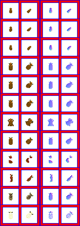
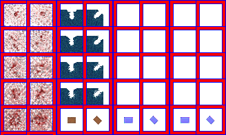

# sprite/animal

These images are the sprite sheets for animals. Each species names its sheet with [`SPRITE`](../01-init/01-animal.md#sprite) in its `init/animal` file, and several species can share one. The folder also holds `_Texture.png`, which all animals share.

## At a glance

| | |
|---|---|
| **Location** | `assets/sprite/animal/` |
| **Files** | One `.png` per sheet, e.g. `Auroch.png`, plus `_Texture.png` |
| **Name** | The file name without `.png`, e.g. `Auroch` |
| **Adding new files** | Yes. A species must name it with `SPRITE`. |
| **Size of a sheet** | Exactly 164 pixels wide and at least 462 high. Anything else stops the game with an error. |

## A species' sheet

The left half of a sheet holds the sprites in colour, and the right half holds a matching normal map, which the game uses to light them.

The left half has 12 rows of 2 cells, and each cell is one sprite. Each cell is 32 pixels square, with 6 pixels between cells and around the edge. That spacing is where vanilla draws its red and blue frames, and the game doesn't read it.

The two cells in a row are the same pose facing two ways: up, and diagonally up and to the right. You only draw those two, because the game rotates each one three more times to make all eight directions.

Move over a sprite on the sheet to see what it's for. The tooltip gives its name in the game's code, then its left edge, top edge, width and height in pixels. The names are only labels, and you don't write them in any file. A sprite with ` normal` after its name is that sprite's normal map, and a sprite the code doesn't name shows its position instead.

This is the vanilla `Auroch.png`:

## _Texture.png

This image holds overlays the game draws on top of every animal, and the crate on a caravan's animal. It must be exactly 328 pixels wide and at least 196 high.

Its left half has two blocks side by side, each laid out like a species' sheet, with 2 cells of 32 pixels in each row. The left block holds five levels of blood, and the right block holds four frames of water and then the crate.

The game only ever draws the left cell of a blood row, whichever way the animal faces, so the right cells of that block are never seen.

This is the vanilla `_Texture.png`:

## Making a sheet

Because the game cuts a sheet by position, the simplest way to make a new one is to copy a vanilla sheet from `base/data.zip`, paint over it and give it a new name.

## Related

- [sprite](00-sprite.md)
- [init/animal](../01-init/01-animal.md)
