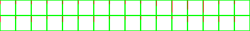

# sprite/font

The images in this folder are the game's fonts. Each holds one picture for every character the game can write, laid out in a grid in the order given by [init/config/Charset.txt](../01-init/03-config/03-Charset.md).

## At a glance

| | |
|---|---|
| **Location** | `assets/sprite/font/` |
| **Files** | `Small.png`, `Medium.png`, `Header1.png` and `Header2.png` |
| **Adding new files** | No. The game loads only these four names. `Small.png` and `Medium.png` must exist. If `Header1.png` or `Header2.png` is missing, the game uses the medium font in its place. |
| **Size** | The width sets the size of the characters (see below). The vanilla files are `Small.png` 2304 by 72, `Medium.png` 3328 by 104, `Header1.png` 4352 by 136 and `Header2.png` 3328 by 104 pixels. |
| **Companion file** | [init/config/Charset.txt](../01-init/03-config/03-Charset.md), which lists the characters in order and can add space between them |

## The fonts

`Small` and `Medium` are the two fonts used for ordinary text across the interface. `Header1` and `Header2` are used for headings and titles. For example, the main menu's buttons and the loading screen's text use `Header1`, and the names of saved games use `Header2`. The launcher uses `Medium` too.

## The sheet

As in most sprite sheets, the left half holds the characters and the right half holds a normal map. Vanilla's normal map is a flat (127, 127, 255) everywhere, which is the simplest thing to copy.

### Cells

Each half is a grid of square cells, 64 across. Every cell has a 1-pixel border on all four sides, so cells are spaced `size + 2` pixels apart. The image's width decides the cell size:

`width = 128 × (size + 2)`

| Vanilla file | Width | Cell size |
|---|---|---|
| `Small.png` | 2304 | 16 |
| `Medium.png`, `Header2.png` | 3328 | 24 |
| `Header1.png` | 4352 | 32 |

The cell size is also the font's height, the height of one line of text. It can be at most 32. A larger font stops the game with the error "Font height too big".

The first character in `CHARS` goes in the top-left cell, and the rest follow left to right, 64 to a row. Character number `i` (counting from 0) has its top-left pixel at:

- x = `(i mod 64) × (size + 2) + 1`
- y = `(i ÷ 64, rounded down) × (size + 2) + 1`

The image needs enough rows of cells for every character in `CHARS`. Vanilla has four rows, room for 256 characters.

### Drawing a character

Draw each character against the left edge of its cell. Vanilla draws them in white, with soft edges made from partly transparent pixels, and the game colours the text as it draws it.

Only a pixel that is completely transparent black, (0, 0, 0, 0), counts as empty. A transparent pixel stored with any other colour counts as part of the character, which can make it wider than it looks.

A character's width is measured from the left edge of its cell to its rightmost pixel that isn't empty. A cell with nothing in it counts as the full width of the cell.

### Lining characters up

Vanilla draws each character at the top of its cell, and the column of border pixels just left of the cell says how far down to move it. The game counts the pixels in that column that aren't pure green (0, 255, 0, 255), and moves the character down by that many pixels. Vanilla paints the column green with red pixels at the top, so the length of the red line is the distance moved. For example, in vanilla `Medium.png`, `!` has 6 red pixels and both `a` and `g` have 10.

Characters that should sit on the same line need the same count. The game then moves every character up or down by one shared amount, worked out from the whole font, so only the differences between characters matter.

The rest of the border, along the top, bottom and right of each cell, is never read.

### Example

This is the top-left corner of the vanilla `Medium.png`: the first 16 cells of its first two rows, holding `!` to `0` and `a` to `p`. Because it starts at the file's top-left corner, its positions are the same as in the full file. The characters are white, so the example is shown on a dark background.

Move over a cell to see which character it holds and its measured width, or over the thin column to its left to see how far that character is moved down. The tooltip gives the left edge, top edge, width and height in pixels.

## Spacing

The game places each character straight after the one before it, with these adjustments:

- **One extra pixel** after a character whose rightmost column contains a pixel with an alpha above 32.
- **[`SPACING`](../01-init/03-config/03-Charset.md#spacing)** from `Charset.txt`: `Medium` and `Header1` add the full value after every character, and `Small` and `Header2` add two thirds of it, rounded down.
- **Closing up gaps between letters.** For two neighbouring letters, the game measures the empty columns on the facing sides of both, separately for the upper and lower half of the character. It then moves the second letter left by the smaller of the two totals, leaving 1 pixel of each letter's gap. If a half of a letter is empty, half the letter's width counts as its gap there. Only letters are measured: digits, punctuation and other characters count as having no gap.

A space is 0.3 times the font's height, rounded up. Spaces, tabs and line breaks don't need a cell.

## Notes

- Mod images aren't layered: the game uses the first copy of each file it finds, so a mod's file takes the place of the vanilla one. A font in a mod replaces that font for every language, as described on the [Charset.txt](../01-init/03-config/03-Charset.md#languages) page.
- Changing the order or number of characters in `CHARS` changes which cell holds which character, so a font and its `Charset.txt` must be changed together.

## Related

- [sprite](00-sprite.md)
- [init/config/Charset.txt](../01-init/03-config/03-Charset.md)
