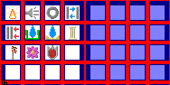

# sprite/icon

These images are the icons used throughout the game's interface. Files in `init` pick an icon by writing its path in an `ICON` tag, such as [`ICON` in init/resource](../01-init/09-resource/01-resource-file.md#icon).

## At a glance

| | |
|---|---|
| **Location** | `assets/sprite/icon/`, in three folders named after the icon size: `16`, `24` and `32` |
| **Files** | One `.png` per sheet, in those folders or in sub-folders of them |
| **Name** | The path to the file, without `.png`, then the icon's number, separated by `->` |
| **Adding new files** | Yes, in any of the three size folders. |
| **Size of a sheet** | See below. |

## Icon paths

An icon path is `SIZE->FOLDERS->IMAGE->NUMBER`. For example, `24->resource->Bread->0` is the first icon in `assets/sprite/icon/24/resource/Bread.png`.

The game's error messages call the number a row. That's only true of sheets one icon wide. The number counts cells from `0`, left to right and then top to bottom.

## A sheet

The left half of a sheet holds the icons in colour, and the right half holds a matching normal map. Each half is a grid of cells of the folder's size, with 6 pixels between cells and around the edge. There can be any number of rows and columns, so a sheet's size is:

- **Width:** 2 × (6 + columns × (size + 6)).
- **Height:** 6 + rows × (size + 6).

A sheet can hold a single icon: the vanilla `24/resource/Bread.png` is 72 pixels wide and 36 high.

A sheet of the wrong size doesn't stop the game. Neither does a path to a missing file, or a number past the end of the sheet. The game draws a plain orange icon instead, and only reports the problem when Debug is on.

Move over an icon on the sheet to see its path. The tooltip also gives its left edge, top edge, width and height in pixels. A cell with ` normal` after its name is that icon's normal map.

This is the vanilla `16/Env.png`, which has 4 columns and 4 rows:

## Related

- [sprite](00-sprite.md)
- [`ICON` in init/room](../01-init/10-room/01-common.md#icon), which also describes combining icons in a block
