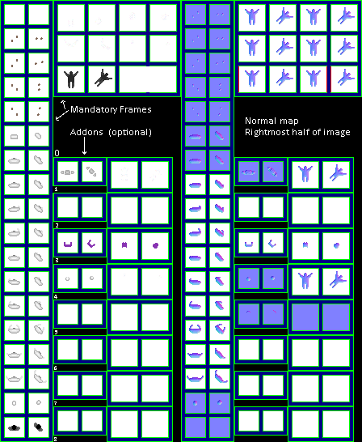

# Body sheets

The images directly inside `sprite/race` are body sheets. A body sheet holds everything needed to draw a person in the settlement: standing poses, lying poses and up to eight add-ons. Each type in a race's sprite file names its sheet with [`SPRITE_FILE`](../../01-init/07-race/06-sprite/02-types-and-faces.md#sprite_file), and several types and races can share one.

## At a glance

| | |
|---|---|
| **Location** | `assets/sprite/race/` |
| **Files** | `Amevia.png`, `Argonosh.png`, `Cantor.png`, `ChildHumanoid.png`, `ChildLizard.png`, `Cretonian.png`, `Dondorian.png`, `Garthimi.png`, `Human.png` and `Tilapi.png` |
| **Name** | The file name without `.png` |
| **Adding new files** | Yes. A type must name it with `SPRITE_FILE`. |
| **Size** | Exactly 448 pixels wide and at least 546 high. Anything else stops the game with an error. |

## The sheet

The left half, 224 pixels wide, holds the sprites in colour, and the right half holds a matching normal map. The left half has three parts:

| Part | Left edge | Top edge | Size in pixels | Cells |
|---|---|---|---|---|
| Standing | 0 | 0 | 66 × 546 | 18 rows of 2 cells, each cell 24 pixels square |
| Lying | 66 | 0 | 158 × 120 | 3 rows of 4 cells, each cell 32 pixels square |
| Add-ons | 66 | 194 | 158 × 352 | 8 rows, each 44 pixels high |

The game doesn't read the space between the lying part and the add-ons.

Move over a sprite on the sheet to see what it's for. This is the vanilla `Human.png`:

## Standing

Each row of the standing part is one piece of the body, as a pair of cells facing up and up-right. The game builds a person from several of these pieces at once.

| Row | Name in the code | What it is | Tinted with |
|---|---|---|---|
| 0 | `IFEET_NONE` | Feet at rest | Leg colour |
| 1 | `IFEET_RIGHT` | Feet, first step to one side | Leg colour |
| 2 | `IFEET_RIGHT2` | Feet, furthest point to one side | Leg colour |
| 3 | `IFEET_LEFT` | Feet, first step to the other side | Leg colour |
| 4 | `IFEET_LEFT2` | Feet, furthest point to the other side | Leg colour |
| 5 | `ITUNIC` | Clothes, drawn over the torso | Clothes colour |
| 6 | `ITORSO_STILL` | Torso at rest | Skin colour |
| 7 to 9 | `ITORSO_RIGHT`, `ITORSO_RIGHT2`, `ITORSO_RIGHT3` | Torso, three poses to one side | Skin colour |
| 10 to 12 | `ITORSO_LEFT`, `ITORSO_LEFT2`, `ITORSO_LEFT3` | Torso, three poses to the other side | Skin colour |
| 13 | `ITORSO_CARRY` | Torso carrying something | Skin colour |
| 14 | `ITORSO_OUT` | Torso, for waving | Skin colour |
| 15 | `ITORSO_OUT2` | Torso, for waving and arms held out | Skin colour |
| 16 | `IHEAD` | Head | Skin colour |
| 17 | `ISHADOW` | The shape of the shadow | Never drawn |

The colours come from the type's [`COLOR_SKIN` and `COLOR_LEG`](../../01-init/07-race/06-sprite/02-types-and-faces.md#color_skin-and-color_leg) and the race's [`COLOR_CLOTHES`](../../01-init/07-race/06-sprite/01-colours-and-extras.md#color_clothes).

A walking person steps through the feet in this order: `IFEET_NONE`, `IFEET_RIGHT`, `IFEET_RIGHT2`, `IFEET_RIGHT`, `IFEET_NONE`, `IFEET_LEFT`, `IFEET_LEFT2`, `IFEET_LEFT`. The torso follows the same pattern, using `ITORSO_STILL` in place of `IFEET_NONE`. Work, fighting and dancing use the other torso poses in orders of their own.

The third pose on each side is used less often: `ITORSO_RIGHT3` and `ITORSO_LEFT3` appear only in some fighting, dancing and arm animations, one frame of an archer's draw (`ITORSO_LEFT3` only), and swimming. `ITORSO_CARRY` is used by anyone riding a mount, by anyone carrying a resource while standing or walking, and by a parent in the `STAND_BABY` animation.

### The order things are drawn in

A standing person is drawn in this order, each piece on top of the last:

1. feet, or the mount for anyone riding one;
2. the [tool](03-extra.md) or [weapon](02-battle.md) in use;
3. torso;
4. clothes, unless the subject is naked;
5. a carried resource or [trolley](03-extra.md);
6. a [baby](05-infant.md), for a parent;
7. add-ons with `BELOW_HEAD: true`;
8. head;
9. the other add-ons;
10. [grit and blood](06-misc.md), drawn through the torso's shape only.

Two situations change this:

- **In water**, the feet aren't drawn. The torso swings through a swimming cycle of the `LEFT` and `RIGHT` poses, including the third pose on each side, and [water](03-extra.md) is drawn through its shape in place of grit and blood.
- **Zoomed far out**, the game draws a simpler person: the torso in the clothes colour (or the skin colour if naked), the head, and the add-ons drawn after the head. There are no feet, separate clothes, tools, weapons, `BELOW_HEAD` add-ons, grit or blood, and a resource carried by hand isn't shown. A mount, a trolley and a baby are still drawn.

## Lying

The lying part holds six pairs of cells, read left to right along each row and then row by row. Each pair faces up and up-right, like the standing pairs.

| Pair | Row and cells | Name in the code | What it is | Tinted with |
|---|---|---|---|---|
| 0 | Row 0, cells 0 and 1 | `CLAY.PANTS` | Legs | Leg colour, or skin colour if naked |
| 1 | Row 0, cells 2 and 3 | `CLAY.TORSO` | Body | Clothes colour, or skin colour if naked |
| 2 | Row 1, cells 0 and 1 | `CLAY.ARMS` | Arms | Skin colour |
| 3 | Row 1, cells 2 and 3 | `CLAY.HEAD` | Head | Skin colour |
| 4 | Row 2, cells 0 and 1 | `CLAY.SHADOW` | The shape used for the shadow, and for drawing blood, grit, water and the gore overlay | Never drawn |
| 5 | Row 2, cells 2 and 3 | None | Loaded, but never drawn | |

These sprites are used for anyone lying down or asleep, for someone flying through the air (the game spins the direction), for corpses, for corpses in a Mass Grave, and for gore.

On a corpse the colours fade towards a dark brown as it decays. A corpse in a Mass Grave is drawn entirely in that brown, without add-ons, and always from the sheet of the race's first type.

## Add-ons

An add-on is an extra piece drawn on the body, such as hair or armour. Each one is listed in the type's [`ADDONS`](../../01-init/07-race/06-sprite/02-types-and-faces.md#addons), which also sets when it's drawn, its colour and whether it goes under the head. The tag `ADDON_INDEX` picks which of the sheet's 8 rows it uses.

Row `ADDON_INDEX` starts `194 + 44 × ADDON_INDEX` pixels from the top of the sheet. In each row, 6 pixels below that top edge, are two pairs of cells:

| Pair | Left edges | Cell size | Used for |
|---|---|---|---|
| Standing | 72 and 102 | 24 pixels | A standing person |
| Lying | 138 and 176 | 32 pixels | A lying person or a corpse |

A row with nothing painted in it draws nothing, so an add-on only appears where you've painted it.

## Related

- [sprite/race](00-race.md)
- [Types and faces](../../01-init/07-race/06-sprite/02-types-and-faces.md)
- [Colours and extras](../../01-init/07-race/06-sprite/01-colours-and-extras.md)
