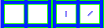

# sprite/race/battle

These images are the weapons and shields seen on soldiers in the settlement. A piece of equipment names its image with `FILE` in its [`SPRITE`](../../01-init/13-stats/04-equip/01-battle.md#sprite) block, and several pieces can share one. [Ranged equipment](../../01-init/13-stats/04-equip/03-ranged.md) has a `SPRITE` block of the same kind.

## At a glance

| | |
|---|---|
| **Location** | `assets/sprite/race/battle/` |
| **Files** | `Bow.png`, `Hammer.png`, `Shield.png`, `Spear.png`, `Sword.png` and `SwordBig.png` |
| **Name** | The file name without `.png` |
| **Adding new files** | Yes. A piece of equipment must name it with `FILE`. |
| **Size** | Exactly 132 pixels wide and at least 36 high. Anything else stops the game with an error. |

## The sheet

The left half, 66 pixels wide, holds one pair of cells, each 24 pixels square, at 6, 6 and 36, 6. The left cell faces up and the right cell faces up and to the right. The right half holds a matching normal map.

Move over a sprite on the sheet to see what it's for. This is the vanilla `Sword.png`:

## How it's drawn

The image is drawn only on a subject who has some of the equipment, and it's drawn under the torso.

Melee and ranged equipment both appear while the subject walks and in the sword animations. Ranged equipment also appears while an archer in a division is shooting.

The block's `COLOR` list tints the image. The game blends along the list according to how much of the equipment the subject has, out of the most they could carry. The image is centred on the point set by `OFFSET_X` and `OFFSET_Y`, moves with the animation by `ANIMATION_DX` and `ANIMATION_DY`, and casts a shadow.

## Related

- [sprite/race](00-race.md)
- [Battle equipment](../../01-init/13-stats/04-equip/01-battle.md)
- [Ranged equipment](../../01-init/13-stats/04-equip/03-ranged.md)
