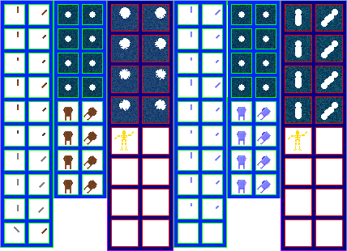

# sprite/race/extra

An extras image holds the tools that subjects work with, the trolley they push, and the water drawn over anyone who's in it. A race's sprite file names its image with [`SPRITE_EXTRA_FILE`](../../01-init/07-race/06-sprite/00-sprite.md#sprite_extra_file). Vanilla has only one, and every race uses it.

## At a glance

| | |
|---|---|
| **Location** | `assets/sprite/race/extra/` |
| **Files** | `Normal.png` |
| **Name** | The file name without `.png` |
| **Adding new files** | Yes, but see [Adding a second image](#adding-a-second-image). |
| **Size** | Exactly 428 pixels wide and at least 310 high. Anything else stops the game with an error. |

## The sheet

The left half, 214 pixels wide, holds the sprites in colour, and the right half holds a matching normal map. The left half has three columns, and each row is a pair of cells facing up and up-right:

| Column | Left edge of the cells | Cell size | Rows |
|---|---|---|---|
| Tools | 6 and 36 | 24 pixels | Rows 0 to 2 are drawn. Rows 3 to 5 are loaded and never drawn. |
| Water and trolley | 72 and 102 | 24 pixels | Rows 0 to 3 are water, and rows 4 to 7 are the trolley. |
| Lying water | 138 and 176 | 32 pixels | Rows 0 to 3 |

Rows of 24-pixel cells start 6 pixels from the top and are 30 pixels apart. Rows of 32-pixel cells start 6 pixels from the top and are 38 pixels apart. The game doesn't read anything below 240 pixels from the first image it loads, though the image must still be 310 high.

Move over a sprite on the sheet to see what it's for. This is the vanilla `Normal.png`:

## Tools

A subject's tool swings through the three tool rows as they work, drawn under the torso without a tint. Each row goes with one torso pose:

| Tool row | Drawn while the torso is |
|---|---|
| 0 | `ITORSO_RIGHT2` |
| 1 | `ITORSO_RIGHT` |
| 2 | `ITORSO_STILL` |

## Water

The four rows of each water column are frames that the game picks by time. They're drawn at 75% opacity through the shape of the body: the torso of someone swimming, and `CLAY.SHADOW` for someone lying in water. A corpse in water uses the lying column too, at 99% opacity.

## Trolley

A subject carrying more than 4 units of a resource pushes a trolley in front of them, with the resource shown on it. The four rows are frames that the game picks by time. The trolley casts a shadow. It isn't tinted, except when zoomed far out, where it takes the colour of the torso.

## Adding a second image

In v0.71.44, only the first extras image the game loads reads its tools from rows 0 to 2. Every later image with a different name reads them from rows 4 to 6, because a counter inside the game isn't reset between images. The water, trolley and lying water columns aren't affected.

If your image might not be the first one loaded, paint the same three tools in rows 0 to 2 and again in rows 4 to 6.

## Related

- [sprite/race](00-race.md)
- [init/race/sprite](../../01-init/07-race/06-sprite/00-sprite.md)
