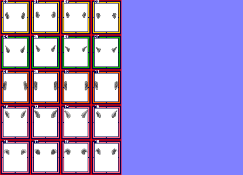
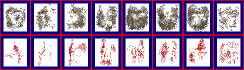
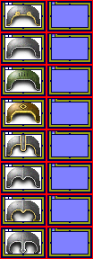

# sprite/race/face

These images are the parts that portraits are built from: skulls, ears, eyes, hair and so on. A race's sprite file picks individual frames from them with [`FRAMES`](../../01-init/07-race/06-sprite/02-types-and-faces.md#frames), and layers them in the order of its `FACE` list. The folder also holds the stains drawn over portraits, and a sub-folder of headwear.

## At a glance

| | |
|---|---|
| **Location** | `assets/sprite/race/face/` |
| **Files** | `Baby.png`, `Beard.png`, `Chest.png`, `Cloak.png`, `Ears.png`, `Eyebrow.png`, `Eyes.png`, `Feature.png`, `Hair.png`, `Makeup.png`, `Mouth.png`, `Mustache.png`, `Nose.png`, `Skull.png`, `SlaveCollar.png` and `Wrinkles.png`, plus `_Overlays.png` and the `addon` folder |
| **Name** | The file name without `.png`, written in `FRAMES` as `File: number` |
| **Adding new files** | Yes. A face part must name it in `FRAMES`. |
| **Size of a part** | Exactly 416 pixels wide and at least 60 high. Anything else stops the game with an error. |

## A face part

The left half, 208 pixels wide, holds the frames in colour, and the right half holds a matching normal map.

A frame is 40 pixels wide and 48 high. Each row of the image is 60 pixels high and holds 4 frames, with their left edges at 6, 58, 110 and 162 pixels and their top edge 6 pixels into the row. A taller image simply has more rows, in whole steps of 60 pixels.

Frames are numbered from 0, left to right along each row and then row by row. So in `FRAMES`, `Ears: 5` is the second frame of the second row.

Frames aren't turned for different directions, because a portrait always faces the viewer.

The game trims blank rows from the top and bottom of each frame and remembers how far down the art started, so a frame is drawn exactly where you painted it. A completely blank frame draws nothing, which vanilla's `Feature.png` uses for frames 20 to 23.

Unverified: a completely blank frame in the last row of an image whose height is an exact multiple of 60 appears from the code to make the game read past the end of the image and stop. Vanilla never does this, so it hasn't been seen in play. To stay clear of it, paint something in those frames, or make the image at least 2 pixels taller than its last row.

Move over a frame on the sheet to see its number. This is the vanilla `Ears.png`:

## _Overlays.png

This image holds the dirt and blood drawn over portraits. The game loads it by name, so you can only change it, and it must exist. It's laid out like a face part, and must be exactly 416 pixels wide and at least 120 high, to hold the 8 frames that the game reads.

| Frames | What they are |
|---|---|
| 0 to 3 | Grit, from lightest to heaviest |
| 4 to 7 | Blood, from lightest to heaviest |

Each stain is drawn at 99% opacity through the shape of every face part whose [`STAINS`](../../01-init/07-race/06-sprite/02-types-and-faces.md#stains) isn't `false`. Blood is tinted with the race's [`COLOR_BLOOD`](../../01-init/07-race/06-sprite/01-colours-and-extras.md#color_blood).

The first frame of each stain appears once the subject's grime or injuries reach 25%, the second at 50%, the third at 75%, and the fourth only at 100%. Below 25%, no stain is drawn.

The game takes a stain tile by tile, from the tile with the same number as the part it's drawing on, counting from the first row that isn't blank. Vanilla's stain frames each paint almost the full 48 pixels of height, so keep yours just as tall. Unverified: what happens when a stain frame has fewer rows than the part it's drawn on.

This is the vanilla `_Overlays.png`:

## face/addon

These images are the headwear drawn over the portraits of rulers, mercenary leaders and raiders. A race's sprite file names them with `FILE` in [`CROWN`, `MERC` and `RAIDER`](../../01-init/07-race/06-sprite/01-colours-and-extras.md#headwear).

| | |
|---|---|
| **Location** | `assets/sprite/race/face/addon/` |
| **Files** | 16 in vanilla, such as `CrownHuman.png`, `EyePatch.png`, `Helm.png` and `RaidHat_H.png` |
| **Adding new files** | Yes. `CROWN`, `MERC` or `RAIDER` must name it with `FILE`. |
| **Size** | Exactly 104 pixels wide and at least 36 high. Anything else stops the game with an error. |

The left half, 52 pixels wide, holds one column of pictures, and the right half holds a matching normal map. Each picture is 40 pixels wide and 24 high, 6 pixels from the left. Each takes a step of 36 pixels down the image, starting 6 pixels from the top, so the number of pictures is the image's height divided by 36.

A ruler always wears the first picture of the first `CROWN` entry. Mercenary and raider leaders are given one at random from all the pictures of all their entries.

This is the vanilla `Helm.png`, with 8 pictures:

## Related

- [sprite/race](00-race.md)
- [Types and faces](../../01-init/07-race/06-sprite/02-types-and-faces.md)
- [Colours and extras](../../01-init/07-race/06-sprite/01-colours-and-extras.md)
