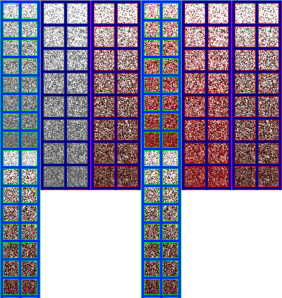
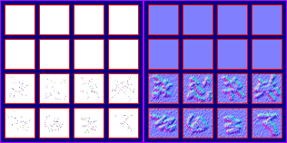

# sprite/race/misc

This folder holds two images that every race shares: `Overlays.png`, the blood and grit drawn on bodies, and `Gore.png`, the shapes used when a body is torn apart. The game loads them by name, so you can only change them, and both must exist.

## At a glance

| | |
|---|---|
| **Location** | `assets/sprite/race/misc/` |
| **Files** | `Gore.png` and `Overlays.png` |
| **Adding new files** | No. The game only loads these two. |
| **Size of `Overlays.png`** | Exactly 460 pixels wide and at least 486 high. Anything else stops the game with an error. |
| **Size of `Gore.png`** | Exactly 316 pixels wide and at least 158 high. Anything else stops the game with an error. |

## Overlays.png

The left half, 230 pixels wide, holds the textures in colour, and the right half holds a matching normal map. The left half has three columns of paired cells:

| Column | Left edge of the cells | Cell size | Rows |
|---|---|---|---|
| Standing | 6 and 36 | 24 pixels | Rows 0 to 7 are blood. Rows 8 to 15 are grit. |
| Lying blood | 72 and 110 | 32 pixels | Rows 0 to 7 |
| Lying grit | 154 and 192 | 32 pixels | Rows 0 to 7 |

Rows of 24-pixel cells start 6 pixels from the top and are 30 pixels apart. Rows of 32-pixel cells start 6 pixels from the top and are 38 pixels apart.

Move over a sprite on the sheet to see what it's for. This is the vanilla `Overlays.png`:

Within each set, a row is a level of severity, from the lightest in the first row to the heaviest in the last. The game multiplies the subject's grime or injuries, from 0 to 1, by 7 and rounds down to choose the row, so the last row only appears at the very maximum. At exactly 0, nothing is drawn.

The game turns each pair of cells 90, 180 and 270 degrees, which makes eight versions of a row. Unlike a body sprite, the version isn't chosen by direction: each subject has a fixed random choice, and keeps it.

These textures aren't drawn as they are. The game uses them to fill in the shape of the body, drawing them through the torso of someone standing and through `CLAY.SHADOW` of someone lying. They're drawn at 75% opacity on living subjects and 99% on corpses. A corpse in a Mass Grave shows only grit, at a level set by how far it has decayed, and a body reduced to gore draws only grit from these textures. Blood is tinted with the race's [`COLOR_BLOOD`](../../01-init/07-race/06-sprite/01-colours-and-extras.md#color_blood).

## Gore.png

The left half, 158 pixels wide, holds the images in colour, and the right half holds a matching normal map. It has 4 rows of 4 cells, each cell 32 pixels square, with left edges at 6, 44, 82 and 120 and top edges at 6, 44, 82 and 120.

| Rows | What they are |
|---|---|
| 0 and 1 | `gore_stencil`, 8 shapes |
| 2 and 3 | `gore_overlay`, 8 images |

When a subject is reduced to gore, the game picks one number from 0 to 7, which stays the same for that subject. The matching stencil cuts the shape of the body's lying sprites and of any add-ons drawn above the head (`BELOW_HEAD: false`), and the matching overlay is drawn on top through `CLAY.SHADOW`, tinted with the race's `COLOR_BLOOD`. These cells aren't turned for different directions.

Unverified: which colour channels of a stencil matter. The sheet shows what vanilla paints, and copying its style is the safest choice.

This is the vanilla `Gore.png`:

## Related

- [sprite/race](00-race.md)
- [Body sheets](01-body.md)
- [Colours and extras](../../01-init/07-race/06-sprite/01-colours-and-extras.md#color_blood)
