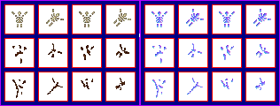

# sprite/race/skelleton

These images are the bones left behind when a corpse has decayed. The folder uses the game's own spelling. A race's sprite file names its images with [`SPRITE_SKELLETON_FILE`](../../01-init/07-race/06-sprite/02-types-and-faces.md#sprite_skelleton_file).

In v0.71.44, adults take their skeleton from the `CHILD` block and children take theirs from the first type. See [Skeletons](../../01-init/07-race/06-sprite/02-types-and-faces.md#skeletons).

## At a glance

| | |
|---|---|
| **Location** | `assets/sprite/race/skelleton/` |
| **Files** | `Argonosh.png`, `Cantor.png`, `Humanoid.png` and `Humanoid_small.png` |
| **Name** | The file name without `.png` |
| **Adding new files** | Yes. `SPRITE_SKELLETON_FILE` must name it. |
| **Size** | Exactly 316 pixels wide and at least 120 high. Anything else stops the game with an error. |

## The sheet

The left half, 158 pixels wide, holds the sprites in colour, and the right half holds a matching normal map. It has 3 rows of 4 cells, each cell 32 pixels square, with left edges at 6, 44, 82 and 120 and top edges at 6, 44 and 82.

The cells form six pairs, read left to right along each row and then row by row. The left cell of a pair faces up and the right cell faces up and to the right.

| Pairs | Row | What they are |
|---|---|---|
| 0 and 1 | 0 | Two versions of the base |
| 2 to 5 | 1 and 2 | Four versions of the top, drawn over the base |

Each skeleton picks one base and one top at random, and keeps them. Both are drawn without a tint and both cast a shadow. Skeletons aren't drawn in water.

Move over a sprite on the sheet to see what it's for. This is the vanilla `Humanoid.png`:

## Related

- [sprite/race](00-race.md)
- [Types and faces](../../01-init/07-race/06-sprite/02-types-and-faces.md#skeletons)
