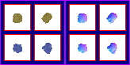

# sprite/race/sleep

A sleep image is the blanket drawn over a subject while they sleep. A race's sprite file names it with [`SLEEP_FILE`](../../01-init/07-race/06-sprite/00-sprite.md#sleep_file). Vanilla has only one, and every race uses it.

## At a glance

| | |
|---|---|
| **Location** | `assets/sprite/race/sleep/` |
| **Files** | `Blanket.png` |
| **Name** | The file name without `.png` |
| **Adding new files** | Yes. `SLEEP_FILE` must name it. |
| **Size** | Exactly 164 pixels wide and at least 44 high, but make it at least 82 high. Anything else stops the game with an error. |

## The sheet

The left half, 82 pixels wide, holds the sprites in colour, and the right half holds a matching normal map. Each row is a pair of cells, each 32 pixels square, with left edges at 6 and 44. Rows start 6 pixels from the top and are 38 pixels apart. The left cell faces up and the right cell faces up and to the right.

Each subject uses one of the first two rows, and keeps it, so a blanket image needs two rows. The vanilla image is 82 pixels high, which fits exactly two. The game loads any further rows, but never draws them. Unverified: what happens with an image only one row high, which the game's minimum height of 44 allows.

Move over a sprite on the sheet to see what it's for. This is the vanilla `Blanket.png`:

## How it's drawn

A sleeping subject is drawn with the lying sprites from their [body sheet](01-body.md), in skin colours as though naked, and the blanket goes on top. The blanket isn't tinted, and casts no shadow of its own.

## Related

- [sprite/race](00-race.md)
- [Body sheets](01-body.md)
- [init/race/sprite](../../01-init/07-race/06-sprite/00-sprite.md#sleep_file)
