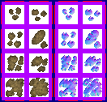

# sprite/race/worldcamp

These images are the small camps that some races keep on the world map. A camp's file names its image with [`SPRITE`](../../01-init/07-race/08-worldcamp.md#sprite).

## At a glance

| | |
|---|---|
| **Location** | `assets/sprite/race/worldcamp/` |
| **Files** | `Argonosh.png` and `Cantor.png` |
| **Name** | The file name without `.png` |
| **Adding new files** | Yes. `SPRITE` must name it. |
| **Size** | Exactly 132 pixels wide and at least 126 high. Anything else stops the game with an error. |

## The sheet

The left half, 66 pixels wide, holds the sprites in colour, and the right half holds a matching normal map. It has 4 rows of 2 cells, each cell 24 pixels square, with left edges at 6 and 36. Rows start 6 pixels from the top and are 30 pixels apart.

The game chooses the row by the camp's size, which is a random number from 0 up to 1 given when the world is generated:

| Row | Used for |
|---|---|
| 0 | A size of exactly 0, which in practice never happens |
| 1 | The smallest third of sizes |
| 2 | The middle third of sizes |
| 3 | The largest third of sizes |

Only the left cell of each row is used. In v0.71.44, the game's calculation for picking between the two cells always comes out as the left one, so the right column is never drawn.

The game also turns the sprite 90, 180 and 270 degrees, and each camp picks one of the four at random. These turns are only for variety and have nothing to do with direction.

The sprite is tinted with the camp's [`COLOR_MASK`](../../01-init/07-race/08-worldcamp.md#color_mask), and it casts a shadow.

Move over a sprite on the sheet to see what it's for. This is the vanilla `Argonosh.png`:

## Related

- [sprite/race](00-race.md)
- [init/race/worldcamp](../../01-init/07-race/08-worldcamp.md)
