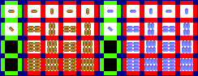
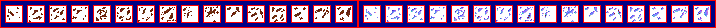
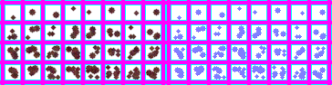
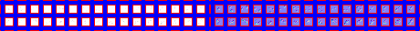

# sprite/resource

These images show resources in the settlement: being carried, lying on the ground, broken into debris, sitting in a deposit and growing as a crop. Each has its own layout and folder.

## At a glance

| | |
|---|---|
| **Location** | `assets/sprite/resource/`, with the sub-folders `debris/`, `minable/` and `growable/` |
| **Files** | One `.png` per sheet |
| **Name** | The file name without `.png`, e.g. `Bread` |
| **Adding new files** | Yes. The file that uses a sheet must name it, and several can share one. |

In every sheet here, the left half holds the sprites in colour and the right half holds a matching normal map, which the game uses to light them. Cells are separated by 6 pixels, with 6 around the edge. That spacing is where vanilla draws its frames, and the game doesn't read it.

Move over a sprite on a sheet to see what it's for. The tooltip gives its name in the game's code, then its left edge, top edge, width and height in pixels. The names are only labels, and you don't write them in any file. A sprite with ` normal` after its name is that sprite's normal map.

## A resource's sheet

A [resource](../01-init/09-resource/01-resource-file.md#sprite) names this sheet with `SPRITE`. It must be exactly 244 pixels wide and at least 94 high, and its cells are 16 pixels square.

The left column holds how the resource looks when carried: one cell facing up and one facing diagonally up and to the right, which the game rotates to make all eight directions. The cell below those is sampled for a colour that nothing uses, and the game doesn't read the bottom cell.

The other four columns hold how the resource looks on the ground, with one row for each size of pile: one, four, nine and sixteen items. A larger pile draws one sprite from the largest row it can, then works through the smaller rows for the rest. The game draws at most 36 items' worth.

This is the vanilla `Bread.png`:

## debris

A resource names one of these sheets with [`SPRITE_DEBRIS`](../01-init/09-resource/01-resource-file.md#sprite_debris). It must be exactly 716 pixels wide and at least 28 high. It holds one row of 16 cells, each 16 pixels square, and the game also uses each one turned 90 degrees.

This is the vanilla `debris/Wood.png`:

## minable

A [deposit](../01-init/09-resource/05-minable.md#sprite) names one of these sheets with `SPRITE`. It must be exactly 364 pixels wide and at least 94 high, and its cells are 16 pixels square.

The game only reads the top two rows, of 8 cells each. Deposits come in four levels, thin to thick. The first two levels use those rows as they are, and the last two use the same rows turned 90 degrees.

The vanilla `Clay.png` has two more rows below these, but in v0.71.44 the game never reads them. Something has to fill that space anyway, because the sheet must be at least 94 pixels high.

This is the vanilla `minable/Clay.png`:

## growable

A [crop](../01-init/09-resource/04-growable.md#spritesprite) names one of these sheets with `SPRITE.SPRITE`. It must be exactly 460 pixels wide and at least 34 high. Its cells are only 8 pixels square, in two rows of 16.

The top row holds the part of the plant set by `SPRITE.GROWTH`, and the bottom row holds the part set by `SPRITE.STEM`. The game tints each with that part's colours.

This is the vanilla `growable/Cotton.png`:

## Making a sheet

Because the game cuts a sheet by position, the simplest way to make a new one is to copy a vanilla sheet from `base/data.zip`, paint over it and give it a new name.

## Related

- [sprite](00-sprite.md)
- [init/resource](../01-init/09-resource/00-resource.md)
