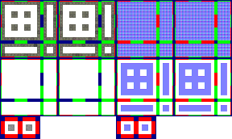

# sprite/room/CANAL

`CANAL.png` holds the banks, the water shapes and the bridges of canals. Culverts and the water pump's canal outlet are drawn from the same sheet.

## At a glance

| | |
|---|---|
| **Location** | `assets/sprite/room/` |
| **File** | `CANAL.png` |
| **Used by** | The canal (`_WATERCANAL`), the culvert (`_WATERDRAIN`) and the outlet tile of the water pump (`_WATERPUMP`) |
| **Adding new files** | No. The game only asks for this name. |
| **Size** | Exactly 288 pixels wide and at least 172 high. Anything else stops the game with an error. |

## The sheet

The left half, 144 pixels wide, holds the sprites in colour, and the right half holds a matching normal map.

| Part | Code name | Position | Layout |
|---|---|---|---|
| Banks | `edge` | 0, 0 and 72, 0 | 2 blocks of 16 pieces, 72 pixels square |
| Water shapes | `stencil` | 0, 72 | 1 block of 16 pieces |
| Water shapes under a bridge | `sroad` | 72, 72 | 1 block of 16 pieces |
| Bridges | `sbridge` | 0, 144 | 2 cells, 16 pixels square |

A block holds one piece for each way a tile can connect to the tiles north, east, south and west of it. Its 16 cells form a 4 by 4 grid starting 2 pixels in from the corner, with a 4-pixel gap before the last column and the last row. The tooltips show which piece is which. The two bridge cells sit in a row with a 6-pixel margin above and to the left, and 6 pixels between them.

Move over a sprite on the sheet to see what it's for. This is the vanilla `CANAL.png`:

## Which sprite is drawn

A canal or culvert tile connects on each side where the next tile is a canal, a culvert or a pump's outlet. The pump's outlet tile is drawn the same way, with one more side counted as connected, set by how the pump is placed.

- **Banks.** The game loads both `edge` blocks twice, once as painted and once turned a quarter clockwise. A piece keeps its meaning in the turned copy, so each tile picks one of 4 versions at random. The bank also casts a low shadow.
- **Water.** The ground's own texture, in the ground's colour darkened to 80%, is drawn through the tile's `stencil` piece. Where water is flowing, the game then draws a moving water texture over it in a dark blue, through a `stencil` piece again. That piece is chosen from the connected sides and whether water flows in the neighbouring tiles. The texture is `Displacement_small.png` from `sprite/textures`, and it scrolls along each direction the water flows.
- **Bridges.** Only canals get bridges, not culverts or the pump's outlet. A canal tile gets one where the tiles on two opposite sides are both floored and can be walked through. The game picks one of 8 bridge sprites at random: the two cells in each of their four turns. The pick doesn't follow which way the bridge runs. The bridge also casts a low shadow.

On a bridge tile, the game gives the renderer the tile's `sroad` piece in place of its `stencil` piece as a depth limit. The ground and water are still drawn through `stencil`. Unverified: how that changes what you see.

## Related

- [sprite/room](00-room.md)
- [init/room: \_WATERCANAL](../../01-init/10-room/15-water.md#_watercanal)
- [init/room: \_WATERDRAIN](../../01-init/10-room/15-water.md#_waterdrain)
- [init/room: \_WATERPUMP](../../01-init/10-room/15-water.md#_waterpump)
- [sprite/room/PUMP](03-pump.md)
