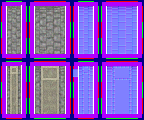

# sprite/room/GATEHOUSE_NORMAL

`GATEHOUSE_NORMAL.png` holds the pieces of the vanilla gatehouse, the gate you build into a wall. A gate is a row of tiles, one or two wide, and the game builds it from end pieces and middle pieces.

## At a glance

| | |
|---|---|
| **Location** | `assets/sprite/room/` |
| **File** | `GATEHOUSE_NORMAL.png` |
| **Name** | The same as the gatehouse's file in `init/room`, here `GATEHOUSE_NORMAL` |
| **Adding new files** | Yes. Every `GATEHOUSE_` room file in `init/room` reads an image of the same name, so a new gatehouse needs its own image here. |
| **Size** | Exactly 144 pixels wide and at least 120 high. Anything else stops the game with an error. |

## The sheet

The left half, 72 pixels wide, holds the sprites in colour, and the right half holds a matching normal map. The game reads only the top 60 rows: two blocks of cells 16 pixels square, with a 6-pixel margin round each block and the cells touching.

| Block | Position | Cells | For |
|---|---|---|---|
| First | 0, 0 | 1 column of 3 | Gates one tile wide |
| Second | 28, 0 | 2 columns of 3 | Gates two tiles wide |

The vanilla image has a second row of blocks, from pixel row 60 down, which the game never reads. The size check still asks for 120 rows.

Move over a sprite on the sheet to see what it's for. This is the vanilla `GATEHOUSE_NORMAL.png`:

## Which sprite is drawn

The names are the code's names for the pieces. As painted, a gate runs north to south. The game turns every piece to match how the gate is placed, and the southern end uses the northern end's piece turned half round.

| Gate | Tiles, from the northern end |
|---|---|
| 1 wide, 2 long | `s1`, `s1` turned |
| 1 wide, 3 long | `s1`, `s2`, `s1` turned |
| 1 wide, 4 long | `s1`, `s2`, `s3`, `s1` turned |
| 2 wide, 5 long | `s1_1 s1_2`, `s2_1 s2_2`, `s3_1 s3_2`, `s2_1 s2_2`, end |
| 2 wide, 6 long | `s1_1 s1_2`, `s2_1 s2_2`, `s3_1 s3_2`, `s2_1 s2_2`, `s3_1 s3_2`, end |
| 2 wide, 7 long | `s1_1 s1_2`, `s2_1 s2_2`, `s3_1 s3_2`, `s2_1 s2_2`, `s3_1 s3_2`, `s2_1 s2_2`, end |

On a gate two tiles wide, the southern end is `s1_2` and `s1_1`, each turned half round, so the end row as a whole is the northern one turned round. The middle pieces are never turned half round, so every middle row of a gate faces the same way.

Each piece also casts a shadow, 16 high. Locking or unlocking the gate doesn't change the sprite.

## Related

- [sprite/room](00-room.md)
- [init/room: GATEHOUSE](../../01-init/10-room/09-infra.md#gatehouse)
