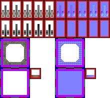

# sprite/room/PUMP

`PUMP.png` holds the turning wheel of the water pump, the rim and water of its pool, and the cover over its canal outlet. The rest of the pump, such as its body, pipes and working parts, comes from the [`SPRITES`](../../01-init/10-room/15-water.md#_waterpump) block of its room file.

## At a glance

| | |
|---|---|
| **Location** | `assets/sprite/room/` |
| **File** | `PUMP.png` |
| **Used by** | The water pump (`_WATERPUMP`) |
| **Adding new files** | No. The game only asks for this name. |
| **Size** | Exactly 220 pixels wide and at least 190 high. The game's own check only asks for 76, but it reads as far as 190. A different width, or an image shorter than 190, stops the game with an error. |

## The sheet

The left half, 110 pixels wide, holds the sprites in colour, and the right half holds a matching normal map. All the cells are 16 pixels square.

| Part | Code name | Position | Layout |
|---|---|---|---|
| Wheel | `sheet` | 0, 0 | 5 blocks side by side, each 22 by 38 pixels |
| Wheel shadows | `sheet` | 0, 38 | 5 more blocks, the same shape |
| Pool rim | `rim` | 0, 76 | 1 block of 3 by 3 cells, 60 pixels square |
| Pool water | `stencil` | 0, 136 | 1 block of 3 by 3 cells, 60 pixels square |
| Outlet cover | `outlet` | 60, 136 | 1 block of 1 cell, 22 pixels square |

The wheel and outlet blocks have a 3-pixel margin round their cells, and each wheel block holds two cells, one above the other. The pool blocks have a 6-pixel margin, and their cells touch.

The game's size check is wrong: it only asks for 76 rows, but the pool and outlet are read from rows 76 to 189. A sheet between 76 and 189 pixels high passes that check, then stops the game with an out-of-bounds error when the pieces are cut out.

Move over a sprite on the sheet to see what it's for. This is the vanilla `PUMP.png`:

## Which sprite is drawn

**The wheel** fills a row of three tiles. The smaller pumps have one wheel and the larger ones two. Each column of wheel blocks is one frame of its animation, from 1 on the left to 5 on the right. The frames run forwards and then backwards, 1 to 5 and back, at about six steps a second, starting from a random point.

| Wheel tile | Cell |
|---|---|
| First | Top cell of the block |
| Middle | Bottom cell of the block |
| Last | Top cell of the block, turned half round, with the frames running the other way |

The game turns all three to match how the pump is placed. The second row of blocks holds the shadow of each wheel cell, in the same place within its block. It's only ever drawn as a shadow, cast with a height of 14.

**The pool** uses the 3 by 3 grids of `rim` and `stencil`, picking the cell from where the tile sits in the pool: on its left edge, in the middle or on its right edge, and on its top edge, in the middle or on its bottom edge.

- The ground's own texture, darkened, is drawn through the `stencil` cell. Then a moving water texture in a dark blue is drawn through it. It's `Displacement_small.png` from `sprite/textures`, and it becomes more opaque as the pool fills.
- The `rim` cell is drawn over the water. It casts two shadows: one of a fixed height, and one that shrinks as the pool fills.

**The outlet** is the tile where water leaves the pump for a canal. The tile itself is drawn like a canal, from [`CANAL.png`](01-canal.md), and the `outlet` cell is drawn over it, turned to match how the pump is placed.

## Related

- [sprite/room](00-room.md)
- [init/room: \_WATERPUMP](../../01-init/10-room/15-water.md#_waterpump)
- [sprite/room/CANAL](01-canal.md)
