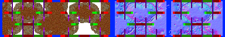

# sprite/room/_DUMP_CORPSE

`_DUMP_CORPSE.png` holds the rim drawn round the edge of the corpse dump. The dump is a room you draw as an area, and this sheet gives it a border that follows whatever shape you draw.

## At a glance

| | |
|---|---|
| **Location** | `assets/sprite/room/` |
| **File** | `_DUMP_CORPSE.png` |
| **Used by** | The corpse dump (`_DUMP_CORPSE`) |
| **Adding new files** | No. The corpse dump is a single room, and it only asks for this name. |
| **Size** | Exactly 384 pixels wide and at least 64 high. Anything else stops the game with an error. |

## The sheet

The left half, 192 pixels wide, holds the sprites in colour, and the right half holds a matching normal map. It holds two blocks of 16 pieces side by side, each 96 by 64 pixels, with cells 16 pixels square. Each piece is for one combination of a tile's four corners.

The cells of a block form a grid of 5 columns and 3 rows, starting 4 pixels in from the block's corner, with 2 pixels between columns and 4 between rows. The piece for no corners shares its cell with another piece and is never drawn, so a block has 15 cells in use. The tooltips show which piece is which.

Move over a sprite on the sheet to see what it's for. This is the vanilla `_DUMP_CORPSE.png`:

## Which sprite is drawn

Only the dump's edge tiles use this sheet. An edge tile is one of the dump's tiles with at least one of its eight neighbours outside the dump. Every other tile shows the sprite of the first floor in the dump's [`FLOOR`](../../01-init/10-room/01-common.md#floor) tag, in that floor's tint, picking one of its first 16 tiles at random. The floor itself isn't laid; only its look is borrowed.

An edge tile's piece depends on its four corners. A corner counts as on the border when the tile diagonally across it and the two tiles either side of it are each outside the dump or are edge tiles themselves. Every edge tile has at least one such corner.

The game loads both blocks twice, once as painted and once turned a quarter clockwise. A piece keeps its meaning in the turned copy, so each edge tile picks one of 4 versions at random.

The game won't let you place a dump that is thinner than 3 tiles anywhere: every tile has to be an inner tile or touch one.

## Related

- [sprite/room](00-room.md)
- [init/room: \_DUMP\_CORPSE](../../01-init/10-room/14-spirit.md#_dump_corpse)
