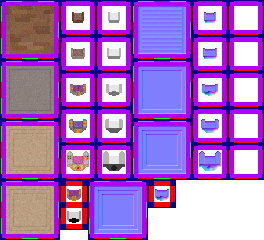

# sprite/room/_THRONE

`_THRONE.png` holds the throne and the floor of the throne room. Both grow grander as the player rises through the levels in `init/player/level`.

## At a glance

| | |
|---|---|
| **Location** | `assets/sprite/room/` |
| **File** | `_THRONE.png` |
| **Used by** | The throne (`_THRONE`) |
| **Adding new files** | No. The throne is a single room, and it only asks for this name. |
| **Size** | Exactly 264 pixels wide and at least 240 high. Anything else stops the game with an error. |

## The sheet

The left half, 132 pixels wide, holds the sprites in colour, and the right half holds a matching normal map.

| Part | Code name | Position | Layout |
|---|---|---|---|
| Floor | `sfloor` | 0, 0 | 4 blocks, one above the other, each 60 pixels square with 3 by 3 cells of 16 pixels |
| Throne | `sthrone` | 60, 0 | A column of 5 cells, 24 pixels square |
| Throne shadow | `sthrone` | 96, 0 | A column of 5 cells, 24 pixels square |

The floor blocks have a 6-pixel margin round their cells, and the cells touch. The throne columns are 36 pixels wide, with each cell 6 pixels in from the column's left edge and 36 pixels below the one above it, starting 6 pixels down.

Move over a sprite on the sheet to see what it's for. This is the vanilla `_THRONE.png`:

## Which sprite is drawn

The throne room is 5 tiles by 3, or 3 by 5 when turned. Each floor tile uses the cell of its place in the room: a corner, a side or the middle. The floor cells aren't turned with the room.

The level picks the floor block and the throne's row. With `index` counting the player's current level from 0, and `count` the number of levels:

- The floor block is 3 × `index` ÷ `count`, rounded down.
- The throne row is 5 × `index` ÷ `count`, rounded down.

So the floor uses only the first three blocks. The fourth block is loaded, but never drawn. With vanilla's fourteen levels:

| Floor block | Levels |
|---|---|
| 0 | `010_MIR` to `031_APPRONTIX` |
| 1 | `032_APPRONTIX_RAY` to `060_DAKORI_RAY` |
| 2 | `070_SORAX` to `100_ASTA_RAY` |

| Throne row | Levels |
|---|---|
| 0 | `010_MIR`, `020_EMIR`, `021_AMARIR` |
| 1 | `030_PRONTIX`, `031_APPRONTIX`, `032_APPRONTIX_RAY` |
| 2 | `040_LEGATI`, `045_LEGATI_RAY`, `050_DAKORI` |
| 3 | `060_DAKORI_RAY`, `070_SORAX`, `080_SORAX_RAY` |
| 4 | `090_ASTA`, `100_ASTA_RAY` |

The throne is drawn once, over the room's centre tile, and spills 4 pixels past the tile on every side. As painted it's for a room placed 5 tiles wide without turning, and the game turns it for the other three ways. The cell beside it in the second column is its shadow, cast with a height of 12. It's only ever drawn as a shadow, turned with the throne.

While a new throne room is being built, each tile that's finished shows the bottom-right floor cell of the current block. The torches round the room come from `TORCH_1X1` in the throne's [`SPRITES`](../../01-init/10-room/09-infra.md#_throne) block, not from this sheet.

The vanilla image also has art below the throne columns, from pixel row 180 down, which the game never reads.

## Related

- [sprite/room](00-room.md)
- [init/room: \_THRONE](../../01-init/10-room/09-infra.md#_throne)
- [init/player/level](../../01-init/06-player/01-level.md)
