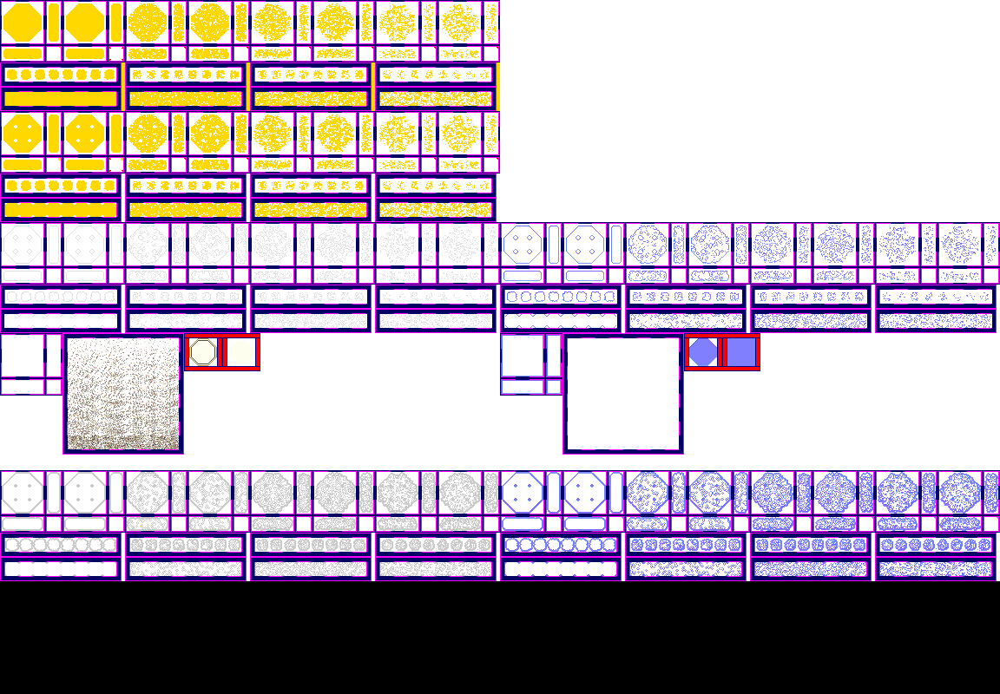

# sprite/settlement/floor

This folder holds one sheet, `_FloorExtra.png`, which every floor and road in the game shares. It holds the shapes a floor's texture is drawn through, the outline of a shaped edge, the seams at a floor's sides, the marks of wear, and the icon. A floor's own tiles come from a [texture in sprite/game](../03-game.md#textures), named with [`GAME_TEXTURE`](../../01-init/12-settlement/03-floor.md#game_texture).

## At a glance

| | |
|---|---|
| **Location** | `assets/sprite/settlement/floor/` |
| **Files** | `_FloorExtra.png` only |
| **Name** | `_FloorExtra`. The game loads this name itself. |
| **Adding new files** | No. A file with another name is ignored. |
| **Size of a sheet** | Exactly 1152 pixels wide and at least 518 high. Anything else stops the game with an error. |

## _FloorExtra.png

The left half of the sheet holds the sprites in colour, and the right half holds a matching normal map, which the game uses to light them.

Every sprite is 16 pixels square. The left half is 576 pixels wide, and its parts are:

| Part | Left edge | Top edge | Size in pixels |
|---|---|---|---|
| Full-square shapes | 0 | 0 | 576 × 128 |
| Shaped edges | 0 | 128 | 576 × 128 |
| Outlines | 0 | 256 | 576 × 128 |
| Seams | 0 | 384 | 72 × 72 |
| Marks of wear | 72 | 384 | 140 × 140 |
| Icon | 212 | 384 | 88 × 44 |

The gaps inside these parts are where vanilla draws its frames, and the game doesn't read them. It doesn't read anything below 518 pixels either, so the extra band of shapes further down the vanilla sheet is never used.

The loader's own height check only asks for 50 pixels. A sheet between 50 and 517 pixels high passes that check, then stops the game with an out-of-bounds error when the pieces are cut out.

Move over a sprite on the sheet to see what it's for. The tooltip gives its name in the game's code, then its left edge, top edge, width and height in pixels. The names are only labels, and you don't write them in any file. A sprite with ` normal` after its name is that sprite's normal map.

This is the vanilla `_FloorExtra.png`:

## The three bands

The top three parts of the sheet are bands with the same arrangement. Across a band are four copies, each 144 pixels wide, one for each level of wear. The least worn is on the left and the most worn on the right. A copy has two blocks of join pieces side by side, with two rows of tiles below them.

A join block is 72 pixels square and has one piece for each way a tile can connect: north, east, south and west, in every combination. Its 16 cells form a 4 by 4 grid starting 2 pixels in from the corner, with a 4-pixel gap before the last column and the last row. The game also turns each piece 90 degrees clockwise and uses it for the connection that results, so a piece for north also serves east. That makes four versions of each connection, and the game picks one at random.

Each row of tiles is 140 pixels wide and 28 high, with eight cells inside a 6-pixel margin. The upper row is a floor with no connections, and the lower row is a floor connected on all four sides. The game also uses these turned 90 degrees and picks one of the sixteen at random. Because these rows cover those two cases, the join pieces for no connections and for all four connections are never drawn as joins.

A side counts as connected if the next tile is any floor, a room, a fortification, a building wall that has been made diagonal, or past the edge of the map. It doesn't have to be the same floor. A floor tile under a roof, inside a room, or switched with the Make Rectangular tool counts as connected on all four sides.

Each band has its own job:

- **The top band** is a full-square shape. It's used for a tile connected on all four sides that also has a floor, or a room that joins with floors, on all four diagonals. It's also used for any floor inside a room, for a tile switched with the Make Rectangular tool, and for every floor when the view is at a quarter of full size or smaller.
- **The middle band** is a shaped edge, used for every other tile.
- **The bottom band** is the outline drawn over a shaped edge, using the same piece as the middle band. It's tinted with the floor's colour.

A tile with a shaped edge also fills in its corners, at the least worn level only. A corner is filled where the two sides next to it are connected and the diagonal tile has a floor, or a room that joins with floors. The fill is the no-connections piece at 54, 182, in the first join block of the middle band. As painted, it's the north-east corner, and the game turns it for the other three.

## Seams, wear and the icon

Below the bands, three parts sit in a row, 384 pixels down.

**Seams.** This block has the same layout as a join block. The game picks a piece by which sides of the tile continue the same floor, and draws it through the tile's shape. It only does this if at least one side doesn't continue the same floor, so the all-sides piece isn't drawn on the map.

**Marks of wear.** This block has 8 rows of 8 cells inside a 6-pixel margin. The row follows how worn the floor is, and the game picks one of its eight variations at random.

**Icon.** These are two blocks side by side, each 44 pixels square, with 2 by 2 cells inside a 6-pixel margin. The game draws the first block as painted. The second block is a shape, which the game fills with the floor's texture and tint and draws on top.

Wear doesn't always come from use. The road laid by `_MAIN_ROAD.txt` is always drawn at the most worn level, and a floor inside a room follows the room's wear.

The path in a temple, set with [`FLOOR_PATH`](../../01-init/10-room/14-spirit.md#floor_path), is drawn differently: its texture fills the whole tile without any shape from the bands. Its marks of wear and its seam are drawn on top, and this is the one place the all-sides seam can appear.

## Making a sheet

Because the game cuts the sheet by position, the simplest way to change it is to copy `_FloorExtra.png` from `base/data.zip` and paint over it. The copy goes at `V71/assets/sprite/settlement/floor/_FloorExtra.png`.

Every floor and road uses this one sheet, so your changes apply to all of them. The game uses the first copy it finds, looking in your mods before vanilla, so two mods that each change this sheet can't be combined. See [What isn't layered](../../../02-Getting-Started.md#what-isnt-layered).

## Related

- [sprite/settlement](00-settlement.md)
- [init/settlement/floor](../../01-init/12-settlement/03-floor.md)
- [sprite/game](../03-game.md)
