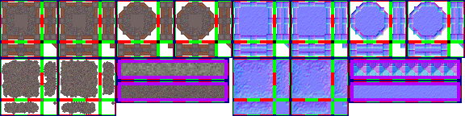
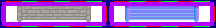

# sprite/settlement/fortification

This folder holds the images for defensive walls and for the stairs that climb them. Each wall names its image with [`SPRITE`](../../01-init/12-settlement/04-fortification.md#sprite) in its `init` file, and several walls can share one image. `_Stairs.png` is a single sheet that every kind of wall uses.

## At a glance

| | |
|---|---|
| **Location** | `assets/sprite/settlement/fortification/` |
| **Files** | `Grand.png`, `Stone.png`, `Wood.png` and `_Stairs.png` |
| **Name** | The file name without its extension, as `SPRITE` gives it. The game loads `_Stairs` itself. |
| **Adding new files** | Yes, for a wall, by naming the new image with `SPRITE`. |
| **Size of a wall sheet** | Exactly 576 pixels wide and at least 144 high. Anything else stops the game with an error. |
| **Size of `_Stairs.png`** | Exactly 216 pixels wide and at least 28 high. Anything else stops the game with an error. |

## A wall sheet

The left half of the sheet holds the sprites in colour, and the right half holds a matching normal map, which the game uses to light them.

Every sprite is 16 pixels square. The left half is 288 pixels wide, and its parts are:

| Part | Left edge | Top edge | Size in pixels |
|---|---|---|---|
| Ordinary joins | 0 | 0 | 144 × 72 |
| Diagonal joins | 144 | 0 | 144 × 72 |
| Broken joins | 0 | 72 | 144 × 72 |
| Lone tiles | 144 | 72 | 140 × 28 |
| Full tiles | 144 | 100 | 140 × 28 |

The gaps inside these parts are where vanilla draws its frames, and the game doesn't read them. It doesn't read anything below 144 pixels either, so the extra height of the vanilla `Grand.png` and `Wood.png` is never used.

Move over a sprite on the sheet to see what it's for. The tooltip gives its name in the game's code, then its left edge, top edge, width and height in pixels. The names are only labels, and you don't write them in any file. A sprite with ` normal` after its name is that sprite's normal map.

This is the vanilla `Stone.png`:

## How a wall tile is chosen

A side of a wall tile counts as connected if the next tile is the same kind of wall, whole or broken, or stairs. A wall of a different kind doesn't count.

The game then picks a sprite by those connections:

- **No connections** uses a lone tile, picked at random.
- **Connected on all four sides** uses a full tile, picked at random. This is the top of a wall, and it's the only part of a whole wall that people can walk on.
- **Anything else** uses a join.

Each row of lone or full tiles is 140 pixels wide and 28 high, with eight cells inside a 6-pixel margin. The game also uses these turned 180 degrees, so it picks from sixteen versions.

Each part of joins holds two blocks side by side, and each block is 72 pixels square. A block has one piece for each way a tile can connect: north, east, south and west, in every combination. Its 16 cells form a 4 by 4 grid starting 2 pixels in from the corner, with a 4-pixel gap before the last column and the last row. The game also turns each piece 180 degrees and uses it for the connection that results, so a piece for north also serves south. That makes four versions of each connection, and the game picks one at random. Because the rows of tiles cover the other two cases, the pieces for no connections and for all four connections are never drawn as joins.

The three parts of joins have these jobs:

- **Ordinary joins** are for a whole wall.
- **Diagonal joins** are for a whole wall switched with the Make Diagonal tool. Lone and full tiles don't change when that tool is used.
- **Broken joins** are for a wall that has been destroyed and not yet repaired or cleared, whether or not it was diagonal. A broken wall uses the same lone and full tiles as a whole wall, with a filth texture drawn through them. People can walk on every part of a broken wall.

Two more things are drawn from this sheet:

- **Inside corners.** The piece for no connections in the first block, at 54, 54, is drawn over a tile where two neighbouring sides are connected and the tile diagonally between them isn't part of the wall. As painted it's the north-east corner, and the game turns it for the other three.
- **The icon.** The wall's icon is made from four pieces of the first block: south and east, south and west, north and east, and north and west. Walls that share an image also share this icon.

Every wall sprite is drawn tinted with the wall's [`COLOR`](../../01-init/12-settlement/04-fortification.md#color). The sprite's own shape is also used for the shadow, which is cast at the wall's [`HEIGHT`](../../01-init/12-settlement/04-fortification.md#height), or half of it for a broken wall.

## _Stairs.png

This sheet works the same way, with colour on the left and a normal map on the right. The left half is 108 pixels wide and holds one row of six sprites, each 16 pixels square, inside a 6-pixel margin. The four in the middle are the steps. The first and last are edges.

The vanilla `_Stairs.png` is shown here. Move over a sprite to see what it's for.

As painted, the steps are for stairs with the wall to the north. The game turns them 90, 180 and 270 degrees for the other three directions, and picks one of the four step sprites at random. A stair tile faces a wall next to it, as long as the tile on the opposite side isn't a wall or stairs. A stair tile with no such wall is drawn as facing north.

The edges are drawn on top of the steps, on the left or right of a stair tile where the next tile isn't stairs. They turn with the steps too. The sprite at the far right of the row is the edge for the west side, and the sprite at the far left is the edge for the east side.

Stairs aren't tinted, and they don't cast a shadow.

## Making a sheet

Because the game cuts a sheet by position, the simplest way to make one is to copy a vanilla image from `base/data.zip` and paint over it. For a new wall, give the copy a new name and use that name in `SPRITE`. It goes in `V71/assets/sprite/settlement/fortification/`.

To change a vanilla image, give your copy the same name. The game uses the first copy it finds, looking in your mods before vanilla, so two mods that each change the same image can't be combined. See [What isn't layered](../../../02-Getting-Started.md#what-isnt-layered). The same applies to `_Stairs.png`, and a change to it affects the stairs of every wall.

## Related

- [sprite/settlement](00-settlement.md)
- [init/settlement/fortification](../../01-init/12-settlement/04-fortification.md)
