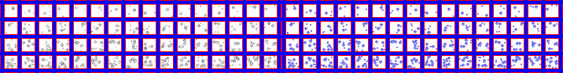

# sprite/settlement/map/Bush

`Bush.png` holds the bushes on the settlement map. The same sprites are also drawn under medium and large trees.

## At a glance

| | |
|---|---|
| **Location** | `assets/sprite/settlement/map/` |
| **File** | `Bush.png` |
| **Adding new files** | No. The game only asks for this name. |
| **Size** | Exactly 716 pixels wide and at least 94 high. Anything else stops the game with an error. |

## The sheet

The left half, 358 pixels wide, holds the sprites in colour, and the right half holds a matching normal map. It has 4 rows of 16 cells, each cell 16 pixels square, with 6 pixels around and between them. A cell's left edge is at 6 plus 22 for each column, and its top edge is at 6 plus 22 for each row.

Move over a sprite on the sheet to see what it's for. This is the vanilla `Bush.png`:

## Which sprite is drawn

The column is picked at random. The row depends on two things:

- The tile's **limit** comes from how many of the eight tiles around it hold a bush or a tree.
- The **weather's moisture** then moves the bush between row 0 and that limit. In fully wet weather, a bush always uses its limit. As the weather dries, the row depends more on chance, and in fully dry weather the row is a random number from 0 to 3, but never above the limit.

| Bushes and trees around it | Limit |
|---|---|
| 0 to 2 | Row 0 |
| 3 or 4 | Row 1 |
| 5 or 6 | Row 2 |
| 7 or 8 | Row 3 |

So paint the rows from sparse to full. A bush under a medium or large tree doesn't count its neighbours. Its limit is random, from row 0 to row 3.

## Tint and shadows

Each bush is tinted with one of the colours from [TreeColors](12-treecolors.md), and casts a shadow in the shape of its sprite. Unless the Graphics setting is at its lowest, the game also draws a moving pattern of dots over the bush at 50% opacity, which makes it look as if it's stirring in the wind.

## Related

- [sprite/settlement/map](00-map.md)
- [TreeColors](12-treecolors.md)
- [Mushroom](08-mushroom.md), which is cut the same way
