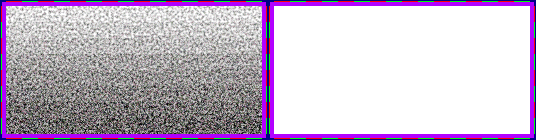

# sprite/settlement/map/Filth

`Filth.png` is a set of grimy textures. They're never drawn on their own. The game draws them through the shape of another sprite, so that the sprite looks dirty.

This isn't the same as the filth drawn on floors, which comes from [`_FloorExtra.png`](../01-floor.md).

## At a glance

| | |
|---|---|
| **Location** | `assets/sprite/settlement/map/` |
| **File** | `Filth.png` |
| **Adding new files** | No. The game only asks for this name. |
| **Size** | Exactly 536 pixels wide and at least 140 high. Anything else stops the game with an error. |

## The sheet

The left half, 268 pixels wide, holds the textures in colour, and the right half holds a matching normal map. It has 8 rows of 16 cells, each cell 16 pixels square. The cells touch each other, inside a 6-pixel margin, so a cell's left edge is at 6 plus 16 for each column and its top edge is at 6 plus 16 for each row.

Move over a sprite on the sheet to see what it's for. This is the vanilla `Filth.png`:

## Which texture is drawn

The column is picked at random. The row is the amount of filth, from 0 to 1, multiplied by 7 and rounded down, so row 7 only appears at the full amount.

| Used by | Amount |
|---|---|
| Room furniture | The room's level of wear, once that's above 0.05 |
| Broken fortification walls | Always 0.75, so always row 5 |

## Related

- [sprite/settlement/map](00-map.md)
- [sprite/settlement/fortification](../02-fortification.md)
- [sprite/game](../../03-game.md)
