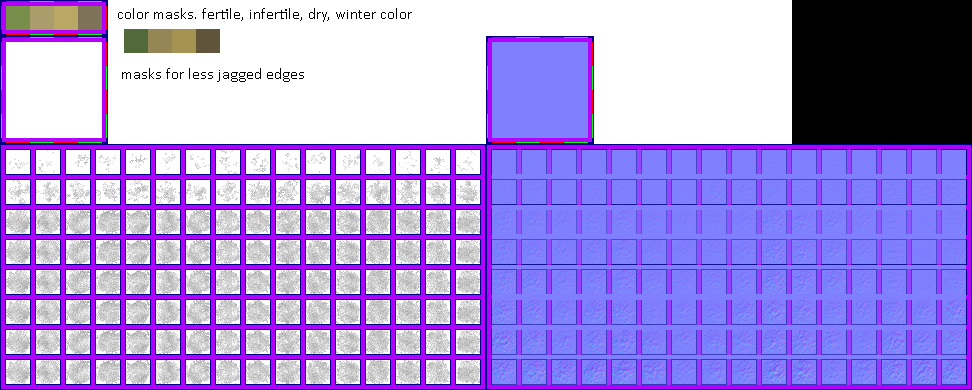

# sprite/settlement/map/Grass

`Grass.png` holds the tufts of grass on the settlement map and the colours that tint them. Under a roof, the game draws [Moss](06-moss.md) in place of grass.

## At a glance

| | |
|---|---|
| **Location** | `assets/sprite/settlement/map/` |
| **File** | `Grass.png` |
| **Adding new files** | No. The game only asks for this name. |
| **Size** | Exactly 972 pixels wide and at least 390 high. Anything else stops the game with an error. |

## The sheet

The left half is 486 pixels wide, and the right half holds a matching normal map for the tufts. The left half has three parts, from top to bottom:

| Part | Top edge | Layout | Used for |
|---|---|---|---|
| Colours | 0 | 8 squares of 24 pixels, touching, in a 6-pixel margin | The first four tint the grass, and the rest aren't read |
| `sheetMask` | 36 | 4 rows of 4 cells of 24 pixels, touching, in a 6-pixel margin | Loaded, but never drawn |
| `sheet` | 144 | 8 rows of 16 cells of 24 pixels, with 6 pixels around and between them | The tufts |

The tufts' cells have left edges at 6 plus 30 for each column, and top edges at 150 plus 30 for each row.

Move over a sprite on the sheet to see what it's for. This is the vanilla `Grass.png`:

## Which tuft is drawn

Each tile has a grass level from 0 to 15, which follows the ground's moisture and type. Level 0 has no grass at all. The column is picked at random, and the row comes from the level:

| Grass level | Row |
|---|---|
| 1 and 2 | 0 |
| 3 and 4 | 1 |
| 5 and 6 | 2 |
| 7 and 8 | 3 |
| 9 and 10 | 4 |
| 11 and 12 | 5 |
| 13 | 6 |
| 14 and 15 | 7 |

At levels 1, 2, 3 and 5 the game randomly lowers the row. At levels 1 and 2 that can take it below row 0, and the tile then draws no grass, so low grass looks patchy. Minerals in the ground lower the row too, but not below row 0.

Each tuft is moved 0 to 7 pixels up and 0 to 7 pixels left at random. The cells are larger than a tile, so a tuft can spill onto nearby tiles.

## Colours

The game reads just the top-left pixel of each of the first four colour squares, so a square's left edge at 6 plus 24 for each column and its top edge at 6 are the pixels that count.

| Square | Name | What it does |
|---|---|---|
| 0 | `fertile` | The colour taller grass moves towards. From level 7, grass blends away from `infertile` towards it, reaching 90% of the way at level 15. |
| 1 | `infertile` | The colour of short grass, at levels 1 to 6. |
| 2 | `dry` | The colour grass moves towards when the weather is dry. |
| 3 | `winter` | The colour grass moves towards in winter, up to 75% of the way. |

The game also makes four slightly different shades of each level's colour, and each tuft uses one of them at random. Over the tufts it draws a moving pattern of dots, stronger the taller the grass.

## Related

- [sprite/settlement/map](00-map.md)
- [Moss](06-moss.md)
- [Snow](10-snow.md), which is laid out like the tufts
