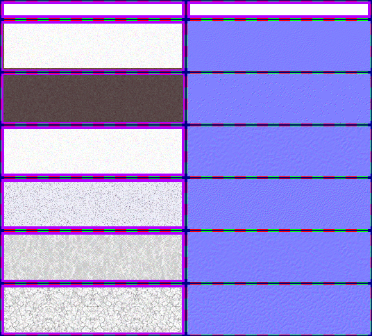

# sprite/settlement/map/Ground

`Ground.png` holds the textures for the six kinds of ground on the settlement map, and the shapes that blend one kind into the next.

## At a glance

| | |
|---|---|
| **Location** | `assets/sprite/settlement/map/` |
| **File** | `Ground.png` |
| **Adding new files** | No. The game only asks for this name. |
| **Size** | Exactly 536 pixels wide and at least 478 high. The game's own check only asks for 408, but it reads as far as 478. A different width, or an image shorter than that, stops the game with an error. |

## The sheet

The left half, 268 pixels wide, holds the sprites in colour, and the right half holds a matching normal map. All the sprites are 16 pixels square and touch each other, inside a 6-pixel margin. Each part starts with a 6-pixel margin at the top.

| Part | Name | Top edge of the part | Rows of 16 |
|---|---|---|---|
| Blend shapes | `s_masks`, then `c_masks` | 0 | 1 |
| Rich | `s_normal` | 28 | 4 |
| Rock | `s_rock` | 104 | 4 |
| Sand | `s_sand` | 180 | 4 |
| Alluvium | `s_tree` | 256 | 4 |
| Till | `s_pasture` | 332 | 4 |
| Infertile | `s_infertile` | 408 | 4 |

Move over a sprite on the sheet to see what it's for. This is the vanilla `Ground.png`:

## Textures

Each kind of ground has 64 tiles, and each map tile picks one at random. The top row is special, because water edges and bridges draw only from it, using one of its 16 tiles. The first four tiles of that row also make up the ground's icon, as a 2 by 2 square.

The ground is tinted according to how wet the tile is. Rock and sand take their colours from [`GROUND_ROCK` and `GROUND_SAND`](../../../01-init/03-config/12-SettColors.md#ground_sand-and-ground_rock) in `SettColors.txt`, and the others from the climate's [`GROUND`](../../../01-init/03-config/02-CLIMATE.md#ground).

## Blending

The eight cells on the left of the top strip, `s_masks`, are straight edges. The eight on the right, `c_masks`, are corners.

Where two tiles meet, one of them draws the other's texture through a blend shape. A tile does this when the neighbour's ground comes later in the order below, or when it's the same ground and the neighbour is wetter.

1. Rich
2. Alluvium
3. Till
4. Infertile
5. Rock
6. Sand

Both sets of shapes are painted for a neighbour to the north, and the game turns them for the other three sides, picking one of the eight at random. A tile normally uses a straight edge. It uses a corner instead when the tile on the next side round has the same ground and moisture as that neighbour, which for a neighbour to the north means the tile to the east.

## Related

- [sprite/settlement/map](00-map.md)
- [init/config/SettColors.txt](../../../01-init/03-config/12-SettColors.md)
- [Water](14-water.md), whose banks are drawn with this texture
