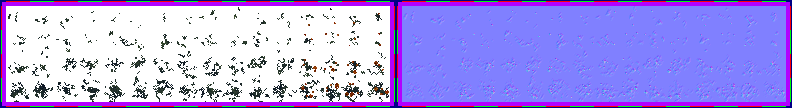

# sprite/settlement/map/Moss

`Moss.png` takes the place of [grass](04-grass.md) on any tile with a roof over it, such as in a cave. It uses the tile's grass level, so a tile with no grass has no moss.

## At a glance

| | |
|---|---|
| **Location** | `assets/sprite/settlement/map/` |
| **File** | `Moss.png` |
| **Adding new files** | No. The game only asks for this name. |
| **Size** | Exactly 792 pixels wide and at least 108 high. Anything else stops the game with an error. |

## The sheet

The left half, 396 pixels wide, holds the sprites in colour, and the right half holds a matching normal map. It has 4 rows of 16 cells, each cell 24 pixels square. The cells touch each other, inside a 6-pixel margin, so a cell's left edge is at 6 plus 24 for each column and its top edge is at 6 plus 24 for each row.

Move over a sprite on the sheet to see what it's for. This is the vanilla `Moss.png`:

## Which sprite is drawn

The column is picked at random, and only the first two rows are ever used:

| Row | Used for |
|---|---|
| 0 | All other grass |
| 1 | Grass that would use row 7 of `Grass.png`, which means levels 14 and 15 with no minerals lowering the row |
| 2 and 3 | Loaded, but never drawn |

Moss isn't tinted. Each sprite is moved 0 to 7 pixels up and 0 to 7 pixels left at random, like grass.

## Related

- [sprite/settlement/map](00-map.md)
- [Grass](04-grass.md)
