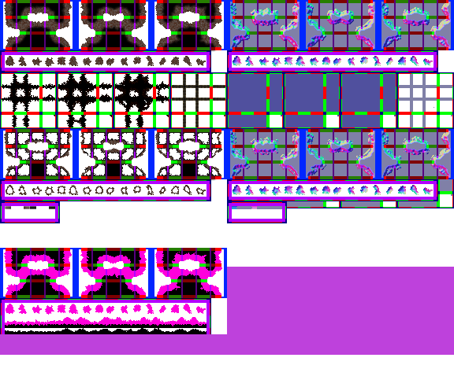

# sprite/settlement/map/Mountain

`Mountain.png` holds the solid mountain walls on the settlement map, and the caves dug into them: their ceilings and their openings.

## At a glance

| | |
|---|---|
| **Location** | `assets/sprite/settlement/map/` |
| **File** | `Mountain.png` |
| **Adding new files** | No. The game only asks for this name. |
| **Size** | Exactly 576 pixels wide and at least 256 high. Anything else stops the game with an error. |

## The sheet

The left half, 288 pixels wide, holds the sprites in colour, and the right half holds a matching normal map. Every sprite is 16 pixels square. The left half has five parts, from top to bottom:

| Part | Top edge | Layout |
|---|---|---|
| Mountain walls | 0 | 3 blocks, each 96 × 64 pixels |
| Lone mountain tiles | 64 | 16 cells in a row, with a 6-pixel margin |
| Cave ceiling edges | 92 | 4 blocks, each 72 pixels square |
| Cave openings | 164 | 3 blocks, each 96 × 64 pixels |
| Lone cave openings | 228 | 16 cells in a row, with a 6-pixel margin |

Vanilla's image is 464 pixels high, but the game doesn't read anything below 256.

Each block has one piece for every combination of four connections. The cells of the 96 × 64 blocks aren't in a simple grid, so use the tooltips to find them. Move over a sprite on the sheet to see what it's for. This is the vanilla `Mountain.png`:

## Mountain walls

The first part's blocks are chosen by a tile's four **corners**. A corner is joined if the tile diagonally away and the two tiles either side of it all count as joining. A tile joins if it's mountain, a cave, a wall of a fortification, or a wall, ceiling or opening of a building. Anything beyond the edge of the map also counts as joining.

| Corners joined | What's drawn | Shadow |
|---|---|---|
| None | One of the 16 lone tiles, picked at random | Yes |
| All four | The first block's piece for all four corners | None |
| Anything else | One of eight versions of the piece for those corners, picked at random | Yes |

The eight versions come from the three blocks. The first is used as painted and turned 90 degrees, and the other two are each used as painted and turned 90 and 180 degrees. Each piece turns with its corners, so a piece for the north-east corner, turned 90 degrees, serves the south-east corner. Pieces for all four corners in the second and third blocks are never drawn.

The icon is made from four pieces of the first block: south-east, south-west, north-east and north-west.

A 96 × 64 block has only 15 cells for its 16 pieces, because the piece for no corners and the piece for the north-east and south-east corners are read from the same cell. The piece for no corners is never drawn, so painting that cell paints the other piece.

Where a mountain wall's north or west side meets a different kind of wall, the game also draws a seam from [WallMerge](13-wallmerge.md).

## Cave ceilings

A cave ceiling draws only its edges and corners from this sheet. A side has an edge when the next tile is wall-like: mountain, a cave opening, a wall of a fortification, or a wall or opening of a building. A plain ceiling isn't wall-like.

Four blocks of edges are used like this:

| Block | Used for |
|---|---|
| First and second | As painted and turned 90 degrees, for an ordinary ceiling |
| Third | As painted, for an ordinary ceiling |
| Fourth | The only edges for the tiles listed below |

That gives an ordinary ceiling five versions of each edge, picked at random.

The fourth block is used for a tile in any room, a tile beside a room that must be indoors, and a tile beside rock that has been tunnelled through or filled in. A tile in a room that must be indoors, or beside one, also gains an edge along that room's boundary.

The piece for no connections has its own job in the first block and the fourth: it's the ceiling's corner, drawn where the tile diagonally away is wall-like and the two tiles either side of it aren't. The fourth block's corner goes with the fourth block's edges. As painted it's the north-east corner, and the game turns it for the other three. The same piece in the second and third blocks isn't drawn.

Four pieces of the first block make the cave's icon, which its openings also use: the pieces for east, south, north and west on their own.

Each ceiling tile casts a shadow in the shape of the mountain wall piece for all four corners, so painting the ceiling doesn't change it.

## Cave openings

An opening is a cave tile at the edge of the cave. Openings use corners, like mountain walls, except that a tile joins if it's wall-like or has a roof.

| Corners joined | What's drawn |
|---|---|
| None | One of the 16 lone openings, picked at random |
| All four | Never happens, because an opening always has at least one corner that isn't joined, so these pieces are never drawn |
| Anything else | One of four versions of the piece for those corners, picked at random |

The four versions are the first block, the second block, the third block, and the third block turned 90 degrees. The same cell-sharing applies as for mountain walls.

An opening's shadow comes from the matching mountain wall sprite, so painting an opening a different shape doesn't change its shadow.

## Related

- [sprite/settlement/map](00-map.md)
- [WallMerge](13-wallmerge.md)
- [sprite/settlement/structure](../05-structure.md), the walls of buildings
