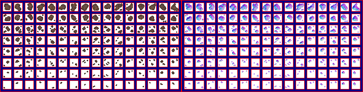

# sprite/settlement/map/Rock

`Rock.png` holds the loose rocks that lie on the settlement map. A rock tile holds an amount from 1 to 15, and people gather it for stone until none is left.

## At a glance

| | |
|---|---|
| **Location** | `assets/sprite/settlement/map/` |
| **File** | `Rock.png` |
| **Adding new files** | No. The game only asks for this name. |
| **Size** | Exactly 716 pixels wide and at least 182 high. Anything else stops the game with an error. |

## The sheet

The left half, 358 pixels wide, holds the sprites in colour, and the right half holds a matching normal map. It has 8 rows of 16 cells, each cell 16 pixels square, with 6 pixels around and between them. A cell's left edge is at 6 plus 22 for each column, and its top edge is at 6 plus 22 for each row.

Move over a sprite on the sheet to see what it's for. This is the vanilla `Rock.png`:

## Which sprite is drawn

Each tile draws one main rock. Row 7 is used when the amount is under 8, and row 6 when it's 8 or more. The column is picked at random.

If the amount is 5 or more, the tile also draws three extra rocks: one half a tile to the right, one half a tile down, and one half a tile to the right and down. The game works through them in that order, spending the amount as it goes:

- While at least 5 of the amount is left, the rock uses row 2, and 5 is taken from the amount.
- Once less is left, the rock uses the row given in the table below, and the amount stays the same. If nothing is left, no rock is drawn.

| Amount left | Row |
|---|---|
| 4 | 3 |
| 3 | 4 |
| 2 | 5 |
| 1 | 6 |

So row 2 is drawn when the most is left, and row 6 when the least is. The first extra rock is always row 2.

Row 0 is never drawn. Row 1 is only used for one cell, which is part of the rock's icon. The icon is made from that cell, column 3 of row 1, and from columns 0, 1 and 2 of row 2.

Rocks aren't tinted, and each one casts a shadow in the shape of its sprite.

## Related

- [sprite/settlement/map](00-map.md)
- [Bush](01-bush.md), which has the same cell layout
