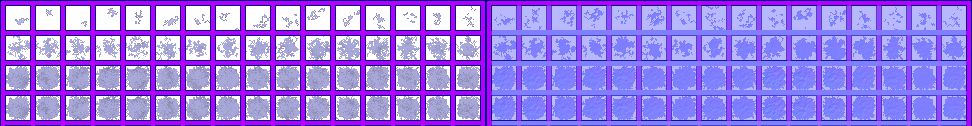

# sprite/settlement/map/Snow

`Snow.png` holds the patches of snow that build up on the settlement map in cold weather.

## At a glance

| | |
|---|---|
| **Location** | `assets/sprite/settlement/map/` |
| **File** | `Snow.png` |
| **Adding new files** | No. The game only asks for this name. |
| **Size** | Exactly 972 pixels wide and at least 126 high. Anything else stops the game with an error. |

## The sheet

The left half, 486 pixels wide, holds the sprites in colour, and the right half holds a matching normal map. It has 4 rows of 16 cells, each cell 24 pixels square, with 6 pixels around and between them. A cell's left edge is at 6 plus 30 for each column, and its top edge is at 6 plus 30 for each row.

Move over a sprite on the sheet to see what it's for. This is the vanilla `Snow.png`:

## Which sprite is drawn

The column is picked at random. The row is the depth of the snow on that tile, from row 0, the shallowest, to row 3, the deepest. The game works it out from how much snow has fallen, then reduces it for the light on the tile, a fixed pattern of high and low spots across the map, and chance.

Two things change that depth:

- Rooms, floors and minerals never go deeper than row 1, and half of them are a row lower still.
- Tiles people path over have less snow.

Each patch is moved 0 to 7 pixels up and 0 to 7 pixels left at random. The cells are larger than a tile, so a patch can spill onto nearby tiles. Snow isn't tinted.

## Where snow isn't drawn

- Anywhere, if the Weather setting is at 0.
- On a tile with a roof, on mountain, or on a wall of a building or fortification.
- On a room that's still being planned.

With the Graphics setting at its lowest, the game treats the amount of snow as a quarter of what it is, so much less appears.

## Related

- [sprite/settlement/map](00-map.md)
- [Grass](04-grass.md)
