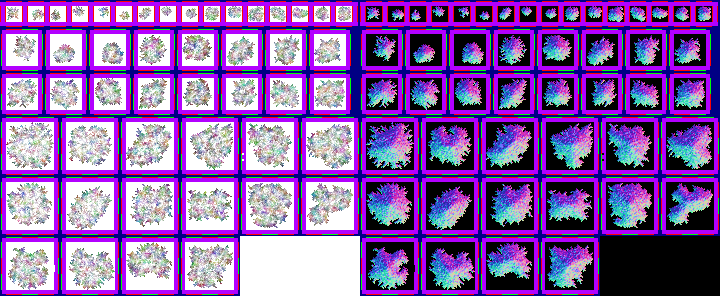

# sprite/settlement/map/Tree

`Tree.png` holds the trees on the settlement map, in three sizes. Rooms can draw the same trees by naming `_TREE` as a sprite, as vanilla's graveyard, fruit orchard and nature monument do. See [sprite/game](../../03-game.md#frames).

## At a glance

| | |
|---|---|
| **Location** | `assets/sprite/settlement/map/` |
| **File** | `Tree.png` |
| **Adding new files** | No. The game only asks for this name. |
| **Size** | Exactly 720 pixels wide and at least 296 high. Anything else stops the game with an error. |

## The sheet

The left half, 360 pixels wide, holds the sprites in colour, and the right half holds a matching normal map. Each tree is one sprite, built from 16-pixel tiles that touch each other. The left half has three parts, from top to bottom:

| Size | Top edge | Space per tree | Sprite | Trees | Left and top of a tree's sprite |
|---|---|---|---|---|---|
| Small, 1 tile | 0 | 22 × 28 | 16 × 16 | 16 in a row | 6 plus 22 for each tree, at 6 |
| Medium, 2 × 2 tiles | 28 | 44 × 44 | 32 × 32 | 8 across, 2 rows | 6 plus 44 for each tree across, at 34 plus 44 for each row |
| Large, 3 × 3 tiles | 116 | 60 × 60 | 48 × 48 | 6 across, 16 in all | 6 plus 60 for each tree across, at 122 plus 60 for each row |

The large trees take up two full rows of six and a last row of four. The rest of that row is never read.

Move over a sprite on the sheet to see what it's for. This is the vanilla `Tree.png`:

## How a tree is drawn

The game also uses every tree turned 90 degrees, so each size has 32 versions, and each tree picks one at random. All the tiles of a medium or large tree use the same version.

A tree is tinted with one of the colours from [TreeColors](12-treecolors.md). It sways with the wind and casts a shadow in the shape of its sprite. Unless the Graphics setting is at its lowest, the game also draws treetop and leaf effects over it.

When a room draws `_TREE`, the tint moves towards the tree's `dry` colour as the room wears down.

Medium and large trees also draw a [bush](01-bush.md) on each tile underneath them, so an empty part of the sprite shows a bush rather than bare ground.

## Related

- [sprite/settlement/map](00-map.md)
- [TreeColors](12-treecolors.md)
- [Bush](01-bush.md)
- [sprite/game](../../03-game.md)
