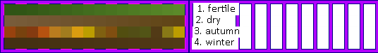

# sprite/settlement/map/TreeColors

`TreeColors.png` holds no sprites. The game reads colours from it to tint trees, bushes and the decorations floating on water.

## At a glance

| | |
|---|---|
| **Location** | `assets/sprite/settlement/map/` |
| **File** | `TreeColors.png` |
| **Adding new files** | No. The game only asks for this name. |
| **Size** | Exactly 536 pixels wide and at least 76 high. Anything else stops the game with an error. |

## The sheet

The sheet has 4 rows of 16 squares, each square 16 pixels across, touching each other inside a 6-pixel margin. The game reads just **one pixel** from each square: its top-left pixel, at 6 plus 16 for each column across and 6 plus 16 for each row down. The rest of the square doesn't matter, and the right half of the image isn't read at all.

| Row | Name | Used |
|---|---|---|
| 0 | `fertile` | Before weather changes the colour |
| 1 | `dry` | In dry weather |
| 2 | `autumn` | In autumn |
| 3 | `winter` | In winter |

Move over a square on the sheet to see which colour it is. This is the vanilla `TreeColors.png`:

## How the colours are used

The game makes 64 colours from each row, by repeating its 16 and giving each a random brightness from 0.9 to 1.1 times. Every tree and bush keeps one of the 64 positions, and the four rows' colours at that position are blended according to the season and the moisture in the weather.

## Related

- [sprite/settlement/map](00-map.md)
- [Tree](11-tree.md)
- [Bush](01-bush.md)
- [init/config/SETT_MAP_DECORATION.txt](../../../01-init/03-config/10-SETT_MAP_DECORATION.md)
