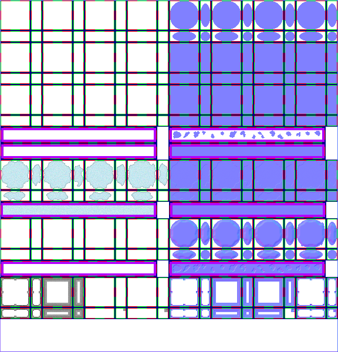

# sprite/settlement/map/Water

`Water.png` holds the shapes of water on the settlement map, the moving shoreline, ice, the banks of shallow water, and bridges.

## At a glance

| | |
|---|---|
| **Location** | `assets/sprite/settlement/map/` |
| **File** | `Water.png` |
| **Adding new files** | No. The game only asks for this name. |
| **Size** | Exactly 576 pixels wide and at least 542 high. The game's own check only asks for 300, but it reads as far as 542. A different width, or an image shorter than that, stops the game with an error. |

## The sheet

The left half, 288 pixels wide, holds the sprites in colour, and the right half holds a matching normal map. Every sprite is 16 pixels square. The left half has these parts, from top to bottom:

| Part | Name | Top edge | Layout |
|---|---|---|---|
| Water shapes | `stencil` | 0 | 4 blocks |
| Shoreline frames | `animation` | 72 | 8 blocks, in 2 rows |
| Lone water shapes | `single_stencil` | 216 | 16 cells |
| Lone water textures | `single_animation` | 244 | 16 cells |
| Ice | `ice` | 272 | 4 blocks |
| Full ice | `ice_fulls` | 344 | 16 cells |
| Banks | `edge` | 372 | 4 blocks |
| Bare bridges | `bridgeRaw` | 444 | 16 cells |
| Bridges | `bridge` | 472 | 4 blocks, of which only the first is drawn |

Each block is 72 pixels square. It has one piece for each way a tile can connect: north, east, south and west, in every combination. Its 16 cells form a 4 by 4 grid starting 2 pixels in from the corner, with a 4-pixel gap before the last column and the last row. A row of 16 cells has a 6-pixel margin at the top and left, and the cells touch.

Vanilla's image is 600 pixels high, but the game doesn't read anything below 542.

Move over a sprite on the sheet to see what it's for. This is the vanilla `Water.png`:

## How water is drawn

A water tile looks at its four sides. A side counts if the next tile is water, or is off the edge of the map. For shallow water, deep water and bridges count as water. For deep water, only other deep water and bridges do.

- **No sides** uses the lone shapes. The game picks one of the 16 at random, fills it with the background colour, then draws the matching lone texture through it.
- **Any other combination** uses `stencil`, picking one of the four blocks at random, and fills the shape with the background colour.
- If at least one side doesn't count, the game also draws the matching `animation` frame through that shape. A tile with water on all four sides has no animation.

Corners are drawn over this, where two sides that count meet and the tile diagonally between them isn't water. The corner comes from the piece for no connections in an `animation` block. It's the north-east corner as painted, and the game turns it for the other three. Only blocks 0, 2, 4 and 6, counting from 0, provide corners, each for its own frame and the next.

## Animation

Frames 0 to 7 are the eight `animation` blocks, read left to right and then row by row. The game plays them 0 to 7, then back down from 6 to 0, and each tile starts at a slightly different point. It moves five steps every second on the game's clock.

## Colours

The water's colours are worked out from [`WATER`](../../../01-init/03-config/12-SettColors.md#water) in `SettColors.txt`, blended between `NORMAL` and `WINTER` by the season.

| Name | Colour |
|---|---|
| Shore | The `WATER` colour as given |
| Normal | The shore colour at half brightness |
| Deep | The normal colour at three-quarters brightness |

Shallow water draws the shape in the normal colour and the frames in the shore colour. Deep water draws the shape in the deep colour and the frames in the normal colour. A deep tile next to shallow water also draws a shallow layer first, using the shore and normal colours, so the two blend.

## Banks

Only shallow water has banks. Each tile draws its `edge` piece for the same sides, with the ground's own texture and colour drawn through its shape. A tile with water on all four sides has no bank. The block is the same as the tile's `stencil` block.

## Ice

Shallow water can freeze, and the game also draws ice in pools. Ice has its own connections: a side counts if the next tile is also ice or is off the edge of the map. A pool works its sides out differently: a side counts only if the tile holds water and the next tile is in the same pool and is water terrain. Ice isn't tinted.

- **All four sides** uses one of the 16 `ice_fulls` tiles, picked at random.
- **Anything else** uses `ice`, picking one of the four blocks at random.

Vanilla leaves the piece for no connections empty in `ice` and in `edge`, but the game does draw them, so a mod can paint them.

## Bridges

A bridge with no floor on it draws a piece of the ground through a lone water shape, then one of the 16 `bridgeRaw` tiles at random, all tinted with the ground's colour.

A bridge with a floor draws the floor, then a piece from the first `bridge` block over it. A side connects if the next tile is also a bridge or isn't solid. This sprite also casts the bridge's shadow. The second `bridge` block and the corner pieces made from the third and fourth blocks are loaded but never drawn.

## Decorations and the icon

Floating decorations on water come from [`WATER_SWEET_1X1`](../../../01-init/03-config/10-SETT_MAP_DECORATION.md) in `SETT_MAP_DECORATION.txt`, not from this sheet.

The water's icon is made from four pieces of the first `stencil` and `edge` blocks: south and east, south and west, north and east, and north and west.

## Related

- [sprite/settlement/map](00-map.md)
- [Ground](05-ground.md)
- [init/config/SettColors.txt](../../../01-init/03-config/12-SettColors.md)
