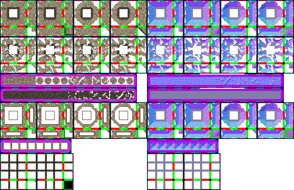

# sprite/settlement/structure

This folder holds the images for the walls, openings and ceilings of buildings. Each structure names its image with [`SPRITE`](../../01-init/12-settlement/05-structure.md#sprite) in its `init` file, and several structures can share one image. All three parts of a building come from that one sheet.

## At a glance

| | |
|---|---|
| **Location** | `assets/sprite/settlement/structure/` |
| **Files** | `Grand.png`, `Mud.png`, `Stone.png` and `Wood.png` |
| **Name** | The file name without its extension, as `SPRITE` gives it |
| **Adding new files** | Yes, by naming the new image with `SPRITE` |
| **Size** | Exactly 576 pixels wide and at least 372 high. Anything else stops the game with an error. |

## The sheet

The left half of the sheet holds the sprites in colour, and the right half holds a matching normal map, which the game uses to light them.

Every sprite is 16 pixels square. The left half is 288 pixels wide, and its parts are:

| Part | Left edge | Top edge | Size in pixels |
|---|---|---|---|
| Ordinary wall joins | 0 | 0 | 144 × 72 |
| Diagonal wall joins | 144 | 0 | 144 × 72 |
| Broken wall joins | 0 | 72 | 144 × 72 |
| Lone wall tiles | 0 | 144 | 268 × 28 |
| Top wall tiles | 0 | 172 | 268 × 28 |
| Ordinary opening joins | 0 | 200 | 144 × 72 |
| Diagonal opening joins | 144 | 200 | 144 × 72 |
| Lone opening tiles | 0 | 272 | 140 × 28 |
| Ceiling edges | 0 | 300 | 144 × 72 |

The gaps inside these parts are where vanilla draws its frames, and the game doesn't read them. It doesn't read anything below 372 pixels either, so the extra height of the vanilla `Mud.png`, which is 900 pixels high, is never used.

Move over a sprite on the sheet to see what it's for. The tooltip gives its name in the game's code, then its left edge, top edge, width and height in pixels. The names are only labels, and you don't write them in any file. A sprite with ` normal` after its name is that sprite's normal map.

This is the vanilla `Stone.png`:

## How the joins work

Walls and openings are drawn according to how they connect with the tiles beside them. A side joins if the next tile is one of these:

- a wall, ceiling or opening of any structure, not only the same one
- a fortification wall, whole or broken, but not fortification stairs
- mountain, or a cave ceiling or opening

A tile is **thick** if two sides next to each other and the tile diagonally between them all join. Thickness changes which sides count as connected:

- A thick tile only connects the sides that belong to such a corner.
- A tile that isn't thick connects every side that joins, except a side facing a thick tile.

Each part of joins is made of blocks, and each block is 72 pixels square. A block has one piece for each way a tile can connect: north, east, south and west, in every combination. Its 16 cells form a 4 by 4 grid starting 2 pixels in from the corner, with a 4-pixel gap before the last column and the last row.

The piece for no connections is at 54, 54 inside its block. In wall and opening blocks it's the **inside corner**, drawn over a tile where two connected sides meet and the tile diagonally between them doesn't join. As painted it's the north-east corner, and the game turns it for the other three.

## Walls

Each wall tile is drawn in one of three ways:

- **No connections** uses a lone tile.
- **Connected on all four sides** uses a top tile, picked at random from eight.
- **Anything else** uses a join.

The rows of lone and top tiles each hold 16 cells inside a 6-pixel margin, and they divide up like this:

| Row | Cells, counting from 0 | Used for |
|---|---|---|
| Lone tiles | 0 to 3 | An ordinary wall |
| Lone tiles | 4 to 7 | A diagonal wall |
| Lone tiles | 8 to 11 | A broken wall |
| Lone tiles | 12 to 15 | A broken diagonal wall |
| Top tiles | 0 to 7 | A whole wall, diagonal or not |
| Top tiles | 8 to 15 | A broken wall, diagonal or not |

The game picks one of the four lone tiles for that kind of wall at random.

Wall joins come in pairs of blocks, side by side. The game uses the first block of a pair as painted and turned 90 degrees, and the second block only turned 180 and 270 degrees. That gives four versions of each connection, and the game picks one at random. Each piece turns with its connections, so a piece for north, turned 90 degrees, serves east. Because the rows of tiles cover the other two cases, the pieces for no connections and for all four connections are never drawn as joins.

The three parts of joins have these jobs:

- **Ordinary joins** are for a whole wall.
- **Diagonal joins** are for a whole wall switched with the Make Diagonal tool, which only changes how walls look.
- **Broken joins** are for a wall that has been destroyed, whether or not it was diagonal.

Inside corners come from the piece for no connections in the first four blocks, depending on the wall:

| Block | Position on the sheet | Inside corner for |
|---|---|---|
| First ordinary | 54, 54 | A wall that isn't thick |
| Second ordinary | 126, 54 | A thick wall |
| First diagonal | 198, 54 | A diagonal wall that isn't thick |
| Second diagonal | 270, 54 | A diagonal thick wall |

A broken wall uses these same corners, chosen the same way.

Whole walls block movement, and broken walls don't.

Where a wall's north or west side joins another wall-like tile, such as the wall of a different structure, the game also draws a seam from `WallMerge.png` in `sprite/settlement/map`.

The wall's icon is made from four pieces of the first block: south and east, south and west, north and east, and north and west. Structures that share an image also share this icon, and the two below.

## Openings

An opening is a ceiling tile at the edge of a building, where at least one of the eight tiles around it doesn't join. The game shows it under the ceiling's name, and people can walk through it.

Openings have four blocks in a row. The first two are ordinary and the last two are diagonal, for an opening switched with Make Diagonal. Each block is used only as painted, so there are two versions of each connection, and the game picks one at random. An opening connected on all four sides draws no join at all.

An opening with no connections uses the row of lone tiles, which holds eight cells inside a 6-pixel margin. The game also uses them turned 90 degrees, so it picks from sixteen versions. Make Diagonal doesn't change them.

Inside corners work as they do for walls. They're at the same places in their blocks, with the first of each pair for a tile that isn't thick and the second for a thick one.

Four pieces of the first block make the structure's main icon, which appears on its building tools and in the room construction window: south and east, south and west, north and east, and north and west.

## Ceilings

The game draws only the edges and corners of a ceiling from this sheet. The two blocks of ceiling edges are each used as painted and turned 90 degrees, which gives four versions of each edge, picked at random.

A side of a ceiling tile gets an edge in these cases:

- The next tile is wall-like: a wall or opening of any structure, a fortification wall, mountain or a cave opening. A plain ceiling isn't wall-like.
- The tile is in a room that must be indoors, and the next tile is outside that room and isn't an opening.
- The tile isn't in such a room, and the next tile is.

The piece for no connections has its own job in each block:

- **The first block's**, at 54, 354, is the ceiling's corner. It's drawn where the tile diagonally away is wall-like and the two tiles either side of that one aren't. As painted it's the north-east corner, and the game turns it for the other three.
- **The second block's**, at 126, 354, is only used for its shape. Every ceiling tile casts a shadow in this shape, and it's never drawn.

The ceiling's icon, which openings also use, is made from four pieces of the first block: north and west, north and east, south and west, and south and east.

## Tint and shadows

Walls and openings are drawn tinted with the structure's [`COLOR`](../../01-init/12-settlement/05-structure.md#color). Ceilings aren't tinted.

A wall's shadow has the shape of the wall's own sprite. A top tile only casts one where it also has an inside corner. An opening's shadow comes from a matching sprite in the wall part of the sheet, so painting an opening a different shape doesn't change its shadow.

## Making a sheet

Because the game cuts a sheet by position, the simplest way to make one is to copy a vanilla image from `base/data.zip` and paint over it. For a new structure, give the copy a new name and use that name in `SPRITE`. It goes in `V71/assets/sprite/settlement/structure/`.

To change a vanilla image, give your copy the same name. The game uses the first copy it finds, looking in your mods before vanilla, so two mods that each change the same image can't be combined. See [What isn't layered](../../../02-Getting-Started.md#what-isnt-layered).

## Related

- [sprite/settlement](00-settlement.md)
- [init/settlement/structure](../../01-init/12-settlement/05-structure.md)
- [sprite/settlement/fortification](02-fortification.md)
