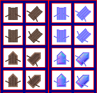

# sprite/settlement/thing/BOAT_DINGY

`BOAT_DINGY.png` holds the small rowing boats of fisheries. A fisherman rows one out onto the water, fishes, and rows back with the catch. While nobody is using it, the boat is moored in the fishery.

## At a glance

| | |
|---|---|
| **Location** | `assets/sprite/settlement/thing/` |
| **File** | `BOAT_DINGY.png` |
| **Adding new files** | No. The game only asks for this name. |
| **Size** | Exactly 164 pixels wide and at least 158 high. Anything else stops the game with an error. |

## The sheet

The left half, 82 pixels wide, holds the boats in colour, and the right half holds a matching normal map. It has 4 rows of 2 cells, each cell 32 pixels square, with 6 pixels around and between them, so a cell's left edge is at 6 plus 38 for each column and its top edge is at 6 plus 38 for each row.

The left column is the boat facing north, and the right column the boat facing north-east. The game turns each one a quarter, a half and three quarters clockwise for the other directions.

Move over a sprite on the sheet to see what it's for. This is the vanilla `BOAT_DINGY.png`:

## Which sprite is drawn

| Rows | Used for |
|---|---|
| 0 and 1 | A fishery at its first level, and at the third, fifth and so on |
| 2 and 3 | A fishery at its second level, and at the fourth, sixth and so on |

Vanilla fisheries have two levels, the room as first built and one upgrade, so the upgrade switches to rows 2 and 3. Each pair of rows is two frames. While a boat is being rowed it switches between them four times a second, and it stays on the first frame while the fisherman fishes. A boat moored in the fishery keeps one of the two frames, and one of the eight directions, picked at random.

Boats drift slowly by up to 2 pixels right and down, and they cast a shadow in the shape of their sprite.

## Related

- [sprite/settlement/thing](00-thing.md)
- [init/room: FISHERY](../../../01-init/10-room/05-food.md#fishery)
