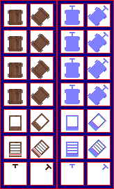

# sprite/settlement/thing/CART

`CART.png` holds the carts of transport rooms and military supply depots, and the harness that ties a cart to the animal pulling it. Each cart is drawn in two layers, with its cargo between them, so the cargo looks as if it sits inside the cart.

## At a glance

| | |
|---|---|
| **Location** | `assets/sprite/settlement/thing/` |
| **File** | `CART.png` |
| **Adding new files** | No. The game only asks for this name. |
| **Size** | Exactly 164 pixels wide and at least 266 high. The game's own check only asks for 234, but it reads as far as 266. A different width, or an image shorter than that, stops the game with an error. |

## The sheet

The left half, 82 pixels wide, holds the sprites in colour, and the right half holds a matching normal map. It has 7 rows of 2 cells, each cell 32 pixels square, with 6 pixels around and between them, so a cell's left edge is at 6 plus 38 for each column and its top edge is at 6 plus 38 for each row.

The left column faces north, and the right column north-east. The game turns each one a quarter, a half and three quarters clockwise for the other directions.

Move over a sprite on the sheet to see what it's for. This is the vanilla `CART.png`:

## Which sprite is drawn

| Row | Used for |
|---|---|
| 0 to 3 | The lower part of every cart, in four frames. As a cart crosses a tile it steps through rows 0, 1 and 2, and on a diagonal step, which is longer, row 3 as well. A cart standing in a room uses row 0. |
| 4 | The upper part of a transport cart, drawn over the cargo |
| 5 | The upper part of a military supply cart, drawn over the cargo |
| 6 | The harness |

A cart is drawn in this order: the lower part, then the cargo it carries, then the upper part. Both parts cast a shadow in the shape of their sprite. Each cart is drawn one pixel back from its position, against the way it faces.

A transport room sends its goods out as a line of four carts behind one pulling animal, and only the first cart has the harness. A military supply depot sends out one cart behind its animal, and that cart always has the harness. Carts parked in these rooms are drawn from the same rows, facing north, east, south or west.

The animal itself comes from the animal's own sprites, not from this sheet.

## Related

- [sprite/settlement/thing](00-thing.md)
- [init/room: _TRANSPORT](../../../01-init/10-room/09-infra.md#_transport)
- [init/room: _MILITARY_SUPPLY](../../../01-init/10-room/12-military.md#_military_supply)
- [sprite/animal](../../01-animal.md)
