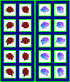

# sprite/settlement/thing/Caravan

`Caravan.png` holds the sprite at the head of a caravan on the settlement map. Caravans unload goods arriving in the settlement at its import rooms, and fetch goods leaving it from its export rooms. Each one is this sprite followed by a line of pack animals carrying the load.

## At a glance

| | |
|---|---|
| **Location** | `assets/sprite/settlement/thing/` |
| **File** | `Caravan.png` |
| **Adding new files** | No. The game only asks for this name. |
| **Size** | Exactly 100 pixels wide and at least 116 high. Anything else stops the game with an error. |

## The sheet

The left half, 50 pixels wide, holds the sprites in colour, and the right half holds a matching normal map. It has 5 rows of 2 cells, each cell 16 pixels square, with 6 pixels around and between them, so a cell's left edge is at 6 plus 22 for each column and its top edge is at 6 plus 22 for each row.

The left column faces north, and the right column north-east. The game turns each one a quarter, a half and three quarters clockwise for the other directions.

Move over a sprite on the sheet to see what it's for. This is the vanilla `Caravan.png`:



## Which sprite is drawn

Each row is one frame of a walking cycle. While the caravan moves, the game runs through this cycle of eight steps as it crosses each tile, using these rows:

```text
0, 1, 2, 1, 0, 3, 4, 3
```

Once the caravan reaches its destination, it shows row 0. The sprite casts a shadow in the shape of its sprite.

The pack animals come from the animals' own sprites, not from this sheet.

## Related

- [sprite/settlement/thing](00-thing.md)
- [sprite/animal](../../01-animal.md)
- [init/room: _IMPORT](../../../01-init/10-room/09-infra.md#_import)
- [init/room: _EXPORT](../../../01-init/10-room/09-infra.md#_export)
