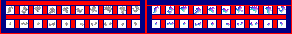

# sprite/settlement/thing/Debris

`Debris.png` holds the small pieces thrown out when something is hit hard or broken. Debris flies out where a projectile that damages an area lands, from room tiles and terrain broken in battle, from an enemy's artillery piece when it's destroyed, and from accidents. The pieces lie on the ground for a while, then disappear.

## At a glance

| | |
|---|---|
| **Location** | `assets/sprite/settlement/thing/` |
| **File** | `Debris.png` |
| **Adding new files** | No. The game only asks for this name. |
| **Size** | Exactly 292 pixels wide and at least 34 high. Anything else stops the game with an error. |

## The sheet

The left half, 146 pixels wide, holds the pieces in colour, and the right half holds a matching normal map. It has 2 rows of 10 cells, each cell 8 pixels square, with 6 pixels around and between them, so a cell's left edge is at 6 plus 14 for each column and its top edge is at 6 plus 14 for each row.

Move over a sprite on the sheet to see what it's for. This is the vanilla `Debris.png`:

## Which sprite is drawn

The game numbers the cells 0 to 19, along the top row and then the bottom row, and picks one at random for each piece. Because of the way it picks, only cells 0 to 3 and 16 to 19 are ever drawn: the first four cells of the top row and the last four of the bottom row. The other twelve are loaded but never seen.

Each piece is darkened by a random amount, and casts a shadow in the shape of its sprite.

## Related

- [sprite/settlement/thing](00-thing.md)
- [Gore](06-gore.md)
- [sprite/settlement/projectile](../04-projectile.md)
