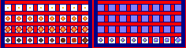

# sprite/settlement/thing/Fire

`Fire.png` holds the flames of the settlement's lights, in three sizes, and the candles that hold the smallest ones. Lights belong to rooms: candles on their furniture, the fires of hearths and shrines, and torch monuments.

## At a glance

| | |
|---|---|
| **Location** | `assets/sprite/settlement/thing/` |
| **File** | `Fire.png` |
| **Adding new files** | No. The game only asks for this name. |
| **Size** | Exactly 236 pixels wide and at least 62 high. Anything else stops the game with an error. |

## The sheet

The left half, 118 pixels wide, holds the sprites in colour, and the right half holds a matching normal map. It has 4 rows of 8 cells, each cell 8 pixels square, with 6 pixels around and between them, so a cell's left edge is at 6 plus 14 for each column and its top edge is at 6 plus 14 for each row.

Move over a sprite on the sheet to see what it's for. This is the vanilla `Fire.png`:

## Which sprite is drawn

Each light picks one of the 8 columns at random and keeps it. The row depends on the kind of light:

| Row | Name in the code | Drawn for |
|---|---|---|
| 0 | `flame_small` | The flame of a candle |
| 1 | `flame_medium` | A small torch monument |
| 2 | `flame_big` | A large torch monument, guard rooms, hearths and shrines |
| 3 | `candle` | The candle itself, drawn with a small flame |

Candles are the most common light. When a room is built, the game puts candles on some of its furniture tiles, the ones the room's code marks as able to hold one, keeping each candle more than 4 tiles from the next. Homes, the throne room, prisons, asylums, temples and arenas also place candles of their own.

Each flame is drawn centred on its light, with sparks around it and a moving fire texture over its tile. The texture comes from `sprite/textures`, not from this sheet. Outdoors, flames only burn at night. Under a roof or in a cave they burn all day. The fires of hearths and shrines always burn. The candle in row 3 is drawn whether its flame is lit or not.

## Related

- [sprite/settlement/thing](00-thing.md)
- [init/room: MONUMENT](../../../01-init/10-room/09-infra.md#monument)
- [Torch](08-torch.md)
