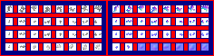

# sprite/settlement/thing/Gore

`Gore.png` holds pieces of flesh, and the same sheet turned a quarter gives the blood drops and pools. Flesh flies out when a person or animal is torn apart, by a hard enough hit or in an execution. Blood drips from people who are wounded, and pools in some rooms where people or animals are killed.

## At a glance

| | |
|---|---|
| **Location** | `assets/sprite/settlement/thing/` |
| **File** | `Gore.png` |
| **Adding new files** | No. The game only asks for this name. |
| **Size** | Exactly 236 pixels wide and at least 62 high. Anything else stops the game with an error. |

## The sheet

The left half, 118 pixels wide, holds the sprites in colour, and the right half holds a matching normal map. It has 4 rows of 8 cells, each cell 8 pixels square, with 6 pixels around and between them, so a cell's left edge is at 6 plus 14 for each column and its top edge is at 6 plus 14 for each row.

Move over a sprite on the sheet to see what it's for. This is the vanilla `Gore.png`:

## Which sprite is drawn

The game loads the 32 cells as painted, then all 32 again turned a quarter clockwise, which gives it 64 sprites. They're used like this:

| Use | Sprites | Shadow |
|---|---|---|
| Flesh | Any of the 64, picked at random | Only the 32 as painted |
| Blood drops | Any of the 32 turned copies, picked at random | No |
| Blood in temples, hunters and cannibal rooms | The turned copies of the first 2 rows | No |

So each cell is both a piece of flesh and, turned, a drop of blood. Paint them so that they work both ways.

Flesh and blood drops are tinted with the blood colour of what they came from, with each colour channel darkened by its own random amount, down to half. A race's blood colour is its [`COLOR_BLOOD`](../../../01-init/07-race/06-sprite/01-colours-and-extras.md#color_blood). Animals all share one red set in the game's code, which no file changes. The blood in hunters' rooms, cannibal rooms and at temple altars where people are sacrificed is tinted with the blood colour alone. At altars where animals are sacrificed, the game binds no colour before drawing the blood. Unverified: whether that leaves it as painted or tinted by whatever was drawn before it. Pieces of flesh lie on the ground for a while, then disappear.

## Related

- [sprite/settlement/thing](00-thing.md)
- [Debris](04-debris.md)
- [init/race: COLOR_BLOOD](../../../01-init/07-race/06-sprite/01-colours-and-extras.md#color_blood)
