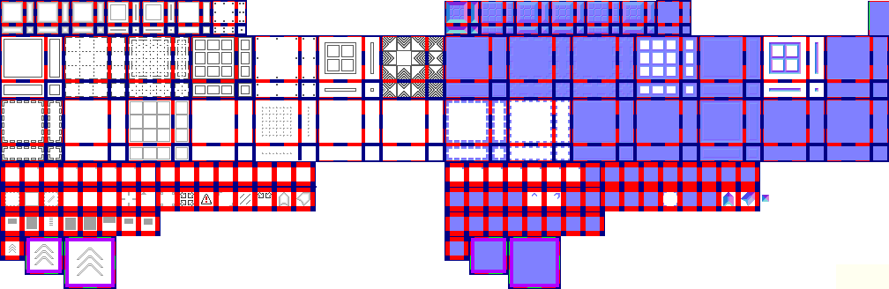

# sprite/ui/Cons

`Cons.png` holds the markings the game draws over the map while you plan and place things: the outlines, dashes and fills that mark out an area, small icons such as the warning sign over a stalled job, and the arrows that show which way a piece faces.

## At a glance

| | |
|---|---|
| **Location** | `assets/sprite/ui/` |
| **File** | `Cons.png` |
| **Adding new files** | No |
| **Size** | Exactly 1008 pixels wide and at least 328 high. Anything else stops the game with an error. |

## The sheet

The left half, 504 pixels wide, holds the sprites in colour, and the right half holds a matching normal map. From top to bottom:

| Part | Top | Layout | Holds |
|---|---|---|---|
| `TINY` | 0 | 7 sets of 16 pieces, 8 pixels square | The marking styles at small size |
| `BIG` | 40 | 14 sets of 16 pieces, 16 pixels square, in two rows of 7 | The marking styles at full size |
| Corners | 184 | One row of 16 cells, 16 pixels square | The inside-corner notch of each `BIG` style |
| `ICO` | 212 | One row of 19 cells, 16 pixels square | Icons |
| `ROT` | 240 | One row of 8 cells, 16 pixels square | Turnable markers |
| `fullArrows` | 268 | A single cell, then 2 by 2 and 3 by 3 blocks | Arrows that show which way a piece faces |

Each set of marking pieces fills a square block, 40 pixels for `TINY` and 72 for `BIG`. Its 16 pieces form a 4 by 4 grid starting 2 pixels in from the block's corner, with a 4-pixel gap before the last column and the last row. The other parts are rows of cells with a 6-pixel margin before each cell.

Move over a sprite on the sheet to see what it's for. This is the vanilla `Cons.png`:

## Which sprite is drawn

### Marking styles

When the game marks out an area, such as the room you're placing, it draws one piece on each tile. The piece shows on which sides the area carries on into the next tile: one piece for each of the 16 ways the four sides can join. All the styles work this way.

The `TINY` sets are, from left to right, `high`, `low`, `flat`, `outline`, `dashed`, `full` and `dots`. The `BIG` sets are numbered from 0, left to right along the top row and then the second:

| Set | Style | Zoomed out, drawn as |
|---|---|---|
| 0 | `outline` | `TINY.outline` |
| 1 | `dashed` | `TINY.dashed` |
| 2 | `dashedThick` | `TINY.dashed` |
| 3 | `solid` | `TINY.full` |
| 4 | `dots` | `TINY.dots` |
| 5 | `line` | `TINY.dashed` |
| 7 | `dashed_hollow` | `TINY.dashed` |
| 9 | `filled` | `TINY.full` |
| 11 | `filled_striped` | `TINY.full` |

When the view is zoomed far out, each `BIG` style is drawn with the `TINY` style in the last column instead. Sets 6, 8, 10, 12 and 13 are never read.

Each `BIG` style also reads one cell of the corner row: the cell under the same number as its set. It holds the notch drawn where a marked area turns an inside corner, painted for the north-east corner; the game turns it for the other three and combines them. Only the borders of each faction's territory on the world map draw these corners, with `outline` and `dashed_hollow`.

### Icons and markers

The `ICO` row holds single icons, such as `warning`, drawn over a job that can't go ahead, and `crosshair`, a target marker. Some are turned by the game to point in four directions. Cells 15 to 18 are never read, and `smallup` is read but never drawn.

Of the `ROT` row, the game draws only `full`: the marker on each tile of a gatehouse while you place it and until that tile is built, turned to show which way the tile faces. The others are loaded but never drawn, and cells 6 and 7 aren't read.

`fullArrows` is drawn on some pieces of an execution ground and a guard post while you place them and until they're built, turned to show which way the piece faces. The game only ever uses the single cell. It also loads the 2 by 2 and 3 by 3 arrows beside it, but never draws them.

## Related

- [sprite/ui](00-ui.md)
- [Colors](01-colors.md): the `MAP` colours these markings are tinted with
