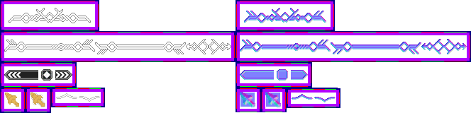

# sprite/ui/Decor

`Decor.png` holds ornaments and small pieces of the interface: the ornament above decorated headings, the borders of decorated frames in the menus, the parts of a slider, the mouse pointer, and the up and down buttons of the small panels on the right of the screen.

## At a glance

| | |
|---|---|
| **Location** | `assets/sprite/ui/` |
| **File** | `Decor.png` |
| **Adding new files** | No |
| **Size** | Exactly 664 pixels wide and at least 160 high. Anything else stops the game with an error. |

## The sheet

The left half, 332 pixels wide, holds the sprites in colour, and the right half holds a matching normal map. Each part is a block of cells that touch, with a 6-pixel margin round the block.

| Part | Position | Cells | Holds |
|---|---|---|---|
| `topDecor` | 0, 0 | 4 of 32 pixels | The ornament above a decorated heading |
| Borders | 0, 44 | 10 of 32 pixels | `_borderTop` (cells 0 to 3), `_borderBottom` (4 to 7) and `_leftRight` (8 and 9) |
| `slider` | 0, 88 | 4 of 24 pixels | The parts of a slider |
| `mouse` | 0, 124 | 1 of 24 pixels | The mouse pointer |
| `mouseHov` | 36, 124 | 1 of 24 pixels | The pointer over something you can click |
| `up` and `down` | 72, 124 | 4 of 16 pixels | Two buttons, each two cells wide |

Move over a sprite on the sheet to see what it's for. This is the vanilla `Decor.png`:

## Which sprite is drawn

**Ornaments and borders.** These are drawn tinted with a colour. `topDecor` is drawn as its four cells side by side, above headings such as the one on the loading screen, tinted with `H1` from [Colors.txt](01-colors.md). A decorated frame has a border along its top and its bottom. Each border is drawn from its four cells: the left end, then the filler repeated, the centre, the filler repeated again, and the right end, so the centre stays in the middle whatever the width. A menu title can also have the two `_leftRight` ornaments on either side of it. Borders and ornaments are tinted with `H1` unless the game asks for another colour.

**Slider.** A horizontal slider is drawn with the button that lowers the value at its left end, the track repeated along it, the handle, and the button that raises the value at its right end. The game loads the four cells again turned a quarter clockwise for vertical sliders. The track is tinted with the text colour `INACTIVE` when the slider can't be used.

**Buttons.** `up` and `down` are each two cells side by side, 32 by 16 pixels, drawn in the small panels on the right of the screen that list races and resources.

## Related

- [sprite/ui](00-ui.md)
- [Colors](01-colors.md)
