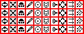

# sprite/ui/DivisionSymbols

`DivisionSymbols.png` holds the symbols shown on the banners of army divisions. Each symbol is a small two-colour picture: the game reads only which of its pixels are black.

## At a glance

| | |
|---|---|
| **Location** | `assets/sprite/ui/` |
| **File** | `DivisionSymbols.png` |
| **Adding new files** | No |
| **Size** | Any. The size sets how many symbols there are. The vanilla sheet is 142 by 58 pixels, with 40 symbols. |

## The sheet

Unlike most sheets, this one has no normal map: the whole image is a grid of symbols. Each symbol is 12 pixels square, and the symbols sit 14 pixels apart, starting 2 pixels in from the top-left corner. So symbol column `x`, row `y` (both counting from 0) has its top-left pixel at `2 + 14x`, `2 + 14y`, and the 2-pixel lines between symbols are never read. Vanilla draws them in red.

The game fits in as many symbols as it can: `(width - 2) / 14` across and `(height - 2) / 14` down, rounded down. They're numbered from 0, left to right along each row and then row by row.

Inside a symbol, a pixel whose colour is pure black (0, 0, 0) is part of the symbol, and any other colour is background. Transparency is ignored, so a fully transparent pixel stored as black still counts as part of the symbol.

Move over a symbol to see its number. This is the vanilla `DivisionSymbols.png`:

## How the symbols are used

Each symbol gets a colour of its own, which the game generates so that the colours differ from each other. The player's divisions start with the symbol of the same number, the first division the first symbol and so on, starting again from the first symbol when there are more divisions than symbols. The player can pick another symbol for a division. Many other armies, such as raiders, invaders and the garrisons of regions, get symbols at random.

In the game, the player can also repaint the symbols and change their colours. The symbols and their colours are stored in each saved game. A changed sheet shows in new games, but loading a game brings back the symbols it was saved with.

## Related

- [sprite/ui](00-ui.md)
- [FactionBanners](05-factionbanners.md): the same format, for faction banners
