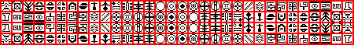

# sprite/ui/FactionBanners

`FactionBanners.png` holds the symbols on the banners of the world's factions. Each symbol is a small two-colour picture: the game reads only which of its pixels are black, and colours the banner itself.

## At a glance

| | |
|---|---|
| **Location** | `assets/sprite/ui/` |
| **File** | `FactionBanners.png` |
| **Adding new files** | No |
| **Size** | Any. The size sets how many symbols there are. The vanilla sheet is 450 by 58 pixels, with 128 symbols. |

## The sheet

This sheet has the same format as [DivisionSymbols.png](04-divisionsymbols.md), and no normal map. Each symbol is 12 pixels square, and the symbols sit 14 pixels apart, starting 2 pixels in from the top-left corner. Symbol column `x`, row `y` (both counting from 0) has its top-left pixel at `2 + 14x`, `2 + 14y`. The 2-pixel lines between symbols are never read; vanilla draws them in red.

The game fits in `(width - 2) / 14` symbols across and `(height - 2) / 14` down, rounded down, numbered from 0 left to right along each row and then row by row.

Inside a symbol, a pixel whose colour is pure black (0, 0, 0) is part of the symbol, and any other colour is background. Transparency is ignored, so a fully transparent pixel stored as black still counts as part of the symbol.

Move over a symbol to see its number. This is the vanilla `FactionBanners.png`:

## How the symbols are used

When a new game is created, the game shuffles the symbols and gives each faction the next one, starting again from the first if there are more factions than symbols. The banner's colours come from [init/world/config/Faction.txt](../../01-init/15-world/02-config/01-Faction.md#colors).

Each faction's banner is stored in the saved game, so a changed sheet only shows in new games. The player's own banner is taken from their saved profile when they have one, so it may not come from this sheet at all.

## Related

- [sprite/ui](00-ui.md)
- [DivisionSymbols](04-divisionsymbols.md)
- [init/world/config/Faction.txt](../../01-init/15-world/02-config/01-Faction.md)
