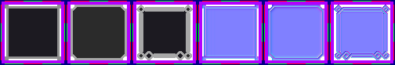

# sprite/ui/Panels

`Panels.png` holds the frames the game draws round windows and panels. There are three frames, each cut into nine pieces that the game repeats to fit any size.

## At a glance

| | |
|---|---|
| **Location** | `assets/sprite/ui/` |
| **File** | `Panels.png` |
| **Adding new files** | No |
| **Size** | Exactly 504 pixels wide and at least 84 high. Anything else stops the game with an error. |

## The sheet

The left half, 252 pixels wide, holds the frames in colour, and the right half holds a matching normal map. Each frame is a block 84 pixels square, holding a 3 by 3 grid of touching cells 24 pixels square, with a 6-pixel margin round them.

| Block | Left edge | Name | Used for |
|---|---|---|---|
| 0 | 0 | `thin` | The default frame of windows |
| 1 | 84 | `butt` | Frames such as side panels and popups |
| 2 | 168 | `big` | Large frames, such as messages and yes-or-no questions |

Move over a piece on the sheet to see what it's for. This is the vanilla `Panels.png`:

## How a frame is drawn

The nine cells are the frame's top-left corner, top edge and top-right corner, then its left edge, middle and right edge, then its bottom-left corner, bottom edge and bottom-right corner. The game covers the panel in 24-pixel steps: corners at the corners, edges repeated along the sides, and the middle repeated over the rest. The last step on each side is moved back so it ends exactly at the panel's edge, overlapping the one before it.

The game can also draw a frame with some of its sides left out. Along a side that's left out, the game draws the piece it would use one step further in: the middle instead of an edge, and an edge instead of a corner.

Each frame also has a margin: the game draws the frame that many pixels further out, on every side, than the area it's asked to frame. The margin is 5 pixels for `thin`, 3 for `butt` and 12 for `big`.

## Related

- [sprite/ui](00-ui.md)
- [TitleBox](08-titlebox.md): the box behind a window's title, and its close button
