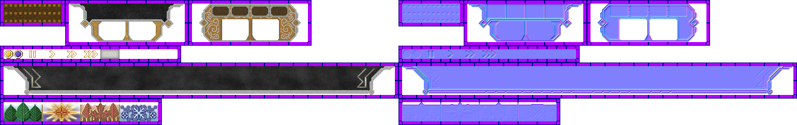

# sprite/ui/Specials

`Specials.png` holds the clock in the top panel, with its sun, moon and seasons, the game speed buttons, and the background of the build panel at the bottom of the settlement view.

## At a glance

| | |
|---|---|
| **Location** | `assets/sprite/ui/` |
| **File** | `Specials.png` |
| **Adding new files** | No |
| **Size** | Exactly 1320 pixels wide and at least 208 high. Anything else stops the game with an error. |

## The sheet

The left half, 660 pixels wide, holds the sprites in colour, and the right half holds a matching normal map. Each part is a block of touching cells with a 6-pixel margin round it.

| Part | Position | Cells | Holds |
|---|---|---|---|
| `clockwork` | 0, 0 | 3 of 32 pixels | The strip behind the clock |
| `background` | 108, 0 | 6 by 2 of 32 pixels | The background behind the clock and speed buttons, drawn as one 192 by 64 image |
| `selest` and `buttons` | 0, 76 | 16 of 16 pixels | The sun and moon (cells 0 and 1), then the speed buttons (cells 2 to 11). Cells 12 to 15 aren't read. |
| `upperPanel` | 0, 104 | 27 by 2 of 24 pixels | The background of the build panel |
| `seasons` | 0, 164 | 8 of 32 pixels | The strip of seasons |

Move over a sprite on the sheet to see what it's for. This is the vanilla `Specials.png`:

## Which sprite is drawn

**The clock.** The clock is the width of the three `clockwork` cells, drawn side by side. The strip slides along by 2 pixels each second of game time, with the part that slides off one end coming back in at the other. Over it, the eight `seasons` cells slide past once a year, in a repeating strip. Both strips are drawn brighter while the mouse is over the clock. The sun (`selest` cell 0) by day, or the moon (cell 1) by night, moves across the clock as the day or night goes on. The battle view leaves out `background` and the clock, and shows only the speed buttons.

**Speed buttons.** There are four, each two cells wide: pause (cells 2 and 3), speed 1 (4 and 5), speed 2 (6 and 7) and speed 3 (8 and 9). Cells 10 and 11 are a glow drawn behind a button that's hovered or selected. The speed 1 button also counts as selected while the game runs at half speed, and the speed 3 button while it runs at the extra speed 4. The button itself is tinted with the text colours from [Colors.txt](01-colors.md): `INACTIVE` if it can't be used, `SELECTED` when selected, the fading hover colours when hovered, and otherwise white.

**Build panel.** The game shows the whole `upperPanel` strip, 648 by 48 pixels, turned half round as the background of the build panel. Paint it upside down: the cell at the bottom right of the strip on the sheet appears, turned, at the top left of the panel.

## Related

- [sprite/ui](00-ui.md)
- [Colors](01-colors.md)
