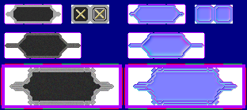

# sprite/ui/TitleBox

`TitleBox.png` holds the boxes drawn behind the title of a window, along its top edge, in three heights to suit the size of the title. It also holds the window's close button.

## At a glance

| | |
|---|---|
| **Location** | `assets/sprite/ui/` |
| **File** | `TitleBox.png` |
| **Adding new files** | No |
| **Size** | Exactly 312 pixels wide and at least 140 high. Anything else stops the game with an error. |

## The sheet

The left half, 156 pixels wide, holds the sprites in colour, and the right half holds a matching normal map. Each part is a block of touching cells with a 6-pixel margin round it.

| Part | Position | Cells | Holds |
|---|---|---|---|
| `titleBoxes[0]` | 0, 0 | 3 of 24 pixels | The title box 24 pixels high |
| `panelClose` | 84, 0 | 2 of 24 pixels | The close button |
| `titleBoxes[1]` | 0, 36 | 3 of 32 pixels | The title box 32 pixels high |
| `titleBoxes[2]` | 0, 80 | 6 by 2 of 24 pixels | The title box 48 pixels high |

Move over a sprite on the sheet to see what it's for. This is the vanilla `TitleBox.png`:

## Which sprite is drawn

**Title boxes.** The game picks the first box that's at least 8 pixels taller than the title's text: the 24-pixel box for text up to 16 pixels high, the 32-pixel box for text up to 24, and otherwise the 48-pixel box.

A box is drawn in three parts. The left end is drawn just left of the title, the middle is repeated across the title one pixel at a time, and the right end is drawn just right of it. In the 24 and 32-pixel boxes, each part is one cell: left end, middle and right end, from left to right. In the 48-pixel box, each part is 2 by 2 cells: the first two columns are the left end, the middle two the middle, and the last two the right end.

**Close button.** The first `panelClose` cell is the button at the top right of a window, and the second is drawn instead while the mouse is over it.

## Related

- [sprite/ui](00-ui.md)
- [Panels](06-panels.md)
