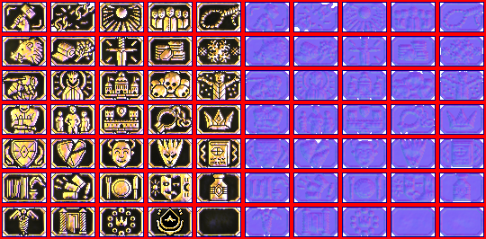

# sprite/ui/Titles

`Titles.png` holds the icons of titles and game modes. A title or mode file in `init/player` picks its icon by number with `ICON_I`.

## At a glance

| | |
|---|---|
| **Location** | `assets/sprite/ui/` |
| **File** | `Titles.png` |
| **Adding new files** | No |
| **Size** | Exactly 540 pixels wide and at least 266 high. The size check asks for only 190 rows, but the main menu stops with an error if there are fewer than 266. |

## The sheet

The left half, 270 pixels wide, holds the icons in colour, and the right half holds a matching normal map. Each icon is 48 by 32 pixels, in a block 54 by 38 pixels with a 3-pixel margin round it. There are 5 blocks across each row.

Icons are numbered from 0, left to right along each row and then row by row, so icon `n` has its top-left pixel at `3 + 54 × (n mod 5)`, `3 + 38 × (n div 5)`. The vanilla sheet has 7 rows, icons 0 to 34.

Move over an icon on the sheet to see its number. This is the vanilla `Titles.png`:

## Which icon is drawn

The game reads as many rows as fit in the image's height, at 38 pixels a row. The main menu always loads the first 35 icons for its list of game modes, so the sheet needs at least 7 rows.

A taller sheet adds 5 icons for each extra row, and [titles](../../01-init/06-player/03-titles.md#icon_i) can use them. [Game modes](../../01-init/06-player/02-mode.md#icon_i) can only use icons 0 to 34.

## Related

- [sprite/ui](00-ui.md)
- [init/player/titles](../../01-init/06-player/03-titles.md)
- [init/player/mode](../../01-init/06-player/02-mode.md)
