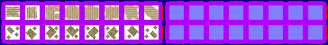

# sprite/world/centre/farm

These images are the fields on the world map. They are drawn on the ground at a region's centre and under the villages scattered across its land. A race names its sheet with `FARM` in its [`WORLD`](../../../01-init/07-race/06-sprite/00-sprite.md#world) block, and tints it with the colours in `FARM_COLOR`.

## At a glance

| | |
|---|---|
| **Location** | `assets/sprite/world/centre/farm/` |
| **Files** | `Farm.png` (most races) and `Garthimi.png` (Argonosh and Garthimi) |
| **Name** | The file name without `.png` |
| **Adding new files** | Yes. A race's `WORLD` block must name it with `FARM`. |
| **Size** | Exactly 364 pixels wide and at least 50 high. Anything else stops the game with an error. |

## The sheet

The left half, 182 pixels wide, holds the sprites in colour, and the right half holds a matching normal map. It has 2 rows of 8 cells, each cell 16 pixels square, with 6 pixels around and between them, so a cell's left edge is at 6 plus 22 for each column and its top edge is at 6 plus 22 for each row.

Move over a sprite on the sheet to see what it's for. This is the vanilla `Farm.png`:

## Which sprite is drawn

All 16 fields are used alike. Each tile picks one at random, and one of the colours in the race's `FARM_COLOR` list, also at random. Fields are see-through and cast no shadow.

- **At a region's centre**, the sheet is that of the race with the most people in the region. Fields are drawn at half opacity on the centre's ground, under its houses. About a quarter of the tiles round the edge of the centre always have a field. When the region holds at least half the people it can, about half the edge tiles have one, and so do about a quarter of the tiles inside.
- **Under villages**, a field is drawn on every tile of a village, at an opacity between 40% and 80%, picked at random. Only about half these tiles get a house as well, so the rest show as fields alone. In v0.71.44 a village's fields use the sheet and colours of a race picked at random from all races, not of the race living there.

## Related

- [sprite/world/centre](00-centre.md)
- [sprite/world/centre/village](05-village.md)
- [init/race: WORLD](../../../01-init/07-race/06-sprite/00-sprite.md#world)
