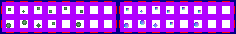

# sprite/world/centre/overlay

These images are small sprites scattered over the houses at a region's centre on the world map, giving a race's towns their own detail. A race names its sheet with `OVERLAY` in its [`WORLD`](../../../01-init/07-race/06-sprite/00-sprite.md#world) block, and tints it with `OVERLAY_COLOR`.

## At a glance

| | |
|---|---|
| **Location** | `assets/sprite/world/centre/overlay/` |
| **Files** | `Cretonian.png`, `Dondorian.png`, `Human.png`, `Normal.png` and `Tilapi.png` |
| **Name** | The file name without `.png` |
| **Adding new files** | Yes. A race's `WORLD` block must name it with `OVERLAY`. |
| **Size** | Exactly 236 pixels wide and at least 34 high. Anything else stops the game with an error. |

## The sheet

The left half, 118 pixels wide, holds the sprites in colour, and the right half holds a matching normal map. It has 2 rows of 8 cells, each cell 8 pixels square, with 6 pixels around and between them, so a cell's left edge is at 6 plus 14 for each column and its top edge is at 6 plus 14 for each row.

Move over a sprite on the sheet to see what it's for. This is the vanilla `Human.png`. Five of its cells are empty, so nothing is drawn when the game picks one of them:

## Which sprite is drawn

All 16 sprites are used alike, one picked at random for each spot. The centre is laid out in spots half a tile wide, the same spots the houses from [`town`](04-town.md) use. An overlay sprite is drawn on a spot more often the nearer it is to the middle and the more people the region holds. Whether a house is drawn on the same spot makes no difference.

The sheet is that of the race with the most people in the region. Each sprite casts a shadow in its own shape.

## Related

- [sprite/world/centre](00-centre.md)
- [sprite/world/centre/town](04-town.md)
- [init/race: WORLD](../../../01-init/07-race/06-sprite/00-sprite.md#world)
