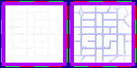

# sprite/world/centre/terrain

These images are the ground beneath a region's centre on the world map, the worn earth the houses stand on. A race names its sheet with `TERRAIN` in its [`WORLD`](../../../01-init/07-race/06-sprite/00-sprite.md#world) block, and tints it with `TERRAIN_COLOR`.

## At a glance

| | |
|---|---|
| **Location** | `assets/sprite/world/centre/terrain/` |
| **Files** | `Dondorian.png`, `Garthimi.png`, `Human.png` and `Normal.png` |
| **Name** | The file name without `.png` |
| **Adding new files** | Yes. A race's `WORLD` block must name it with `TERRAIN`. |
| **Size** | Exactly 152 pixels wide and at least 76 high. Anything else stops the game with an error. |

## The sheet

The left half, 76 pixels wide, holds the sprites in colour, and the right half holds a matching normal map. It holds one block of 4 rows of 4 cells, each cell 16 pixels square. The block has a 6-pixel margin, and the cells inside it touch, so a cell's left edge is at 6 plus 16 for each column and its top edge is at 6 plus 16 for each row.

Move over a sprite on the sheet to see what it's for. This is the vanilla `Human.png`:

## Which sprite is drawn

The centre of a faction's capital is 4 tiles square, and the centre of any other region is 3 tiles square. Each of its tiles picks one of the 16 cells at random, and all are used alike.

The cell isn't drawn whole. It's drawn through a shape from `sprite/world/map/buildings/TerrainStencil.png`, which holds 3 rows of 3 shapes: one for each corner, one for each side and one for the middle. Each tile uses the shape for its place in the centre, so the edges of the ground take the outline painted in that file. In a capital's centre, the two middle tiles of each side share the side's shape, and the four middle tiles share the middle one.

The sheet is that of the race with the most people in the region. The ground casts no shadow.

## Related

- [sprite/world/centre](00-centre.md)
- [sprite/world/centre/farm](01-farm.md)
- [init/race: WORLD](../../../01-init/07-race/06-sprite/00-sprite.md#world)
