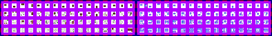

# sprite/world/centre/town

These images are the houses at a region's centre on the world map. The town grows outwards and its houses grow larger as the region's population rises. A race names its sheet with `TOWN` in its [`WORLD`](../../../01-init/07-race/06-sprite/00-sprite.md#world) block, and tints it with `TOWN_COLOR`.

## At a glance

| | |
|---|---|
| **Location** | `assets/sprite/world/centre/town/` |
| **Files** | `Cretonian.png`, `Garthimi.png`, `Human.png` and `Normal.png` |
| **Name** | The file name without `.png` |
| **Adding new files** | Yes. A race's `WORLD` block must name it with `TOWN`. |
| **Size** | Exactly 460 pixels wide and at least 62 high. Anything else stops the game with an error. |

## The sheet

The left half, 230 pixels wide, holds the sprites in colour, and the right half holds a matching normal map. It has 4 rows of 16 cells, each cell 8 pixels square, with 6 pixels around and between them, so a cell's left edge is at 6 plus 14 for each column and its top edge is at 6 plus 14 for each row.

Move over a sprite on the sheet to see what it's for. This is the vanilla `Human.png`:

## Which sprite is drawn

Each row is one size of house, from the smallest in row 0 to the largest in row 3. A house picks one of the 16 cells in its row at random.

The centre is laid out in spots half a tile wide: 8 spots square for a faction's capital and 6 for any other region. Each spot has a weight, highest in the middle and lowest at the corners. The middle spots always have a house. A spot further out gets one once the region holds enough people, and the more people, and the nearer the middle, the larger the house. A little randomness is added to each spot, so the edge of the town is uneven.

When the region has a garrison, one of the four middle spots shows the garrison from `sprite/world/map/buildings/Garrison.png` instead of a house.

The sheet is that of the race with the most people in the region. Each house casts a shadow in its own shape. At night, a light shows in some of the houses. The light is drawn by the game, not taken from the sheet.

## Related

- [sprite/world/centre](00-centre.md)
- [sprite/world/centre/overlay](02-overlay.md)
- [init/race: WORLD](../../../01-init/07-race/06-sprite/00-sprite.md#world)
