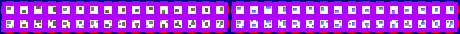

# sprite/world/centre/village

These images are the small houses of the villages scattered across a region's land on the world map. A race names its sheet with `VILLAGE` in its [`WORLD`](../../../01-init/07-race/06-sprite/00-sprite.md#world) block, and tints it with `VILLAGE_COLOR`.

## At a glance

| | |
|---|---|
| **Location** | `assets/sprite/world/centre/village/` |
| **Files** | `Garthimi.png`, `Human.png` and `Normal.png` |
| **Name** | The file name without `.png` |
| **Adding new files** | Yes. A race's `WORLD` block must name it with `VILLAGE`. |
| **Size** | Exactly 460 pixels wide and at least 34 high. Anything else stops the game with an error. |

## The sheet

The left half, 230 pixels wide, holds the sprites in colour, and the right half holds a matching normal map. It has 2 rows of 16 cells, each cell 8 pixels square, with 6 pixels around and between them, so a cell's left edge is at 6 plus 14 for each column and its top edge is at 6 plus 14 for each row.

Move over a sprite on the sheet to see what it's for. This is the vanilla `Human.png`:

## Which sprite is drawn

All 32 cells are used alike, one picked at random for each house.

The world map marks some tiles as places for villages. How many of them show depends on the region's population, lowered by any devastation, and none show on a tile that's fully forest or on large water. A tile that shows gets fields from [`farm`](01-farm.md), and about half of them get a house as well. The house sits at a random offset of up to 7 pixels right and down within its tile.

Villages are shared out between the races living in the region by population, and each is drawn with its own race's sheet. Each house casts a shadow in its own shape. At night, a light shows in some of the houses. The light is drawn by the game, not taken from the sheet.

## Related

- [sprite/world/centre](00-centre.md)
- [sprite/world/centre/farm](01-farm.md)
- [init/race: WORLD](../../../01-init/07-race/06-sprite/00-sprite.md#world)
